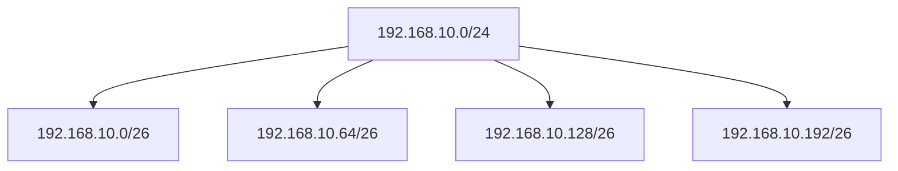
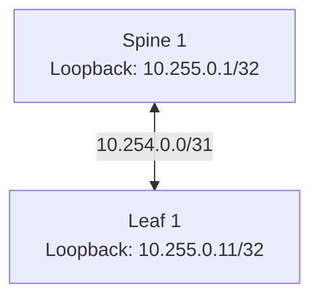

# Endereçamento IPv4, Máscaras, Subnetting e CIDR

> **Origem:** revisão das anotações do CCNA Data Center — DCICN 640-911, páginas 3–5.  
> **Escopo:** representação IPv4, classes históricas, máscaras, CIDR, VLSM, endereços privados e aplicações em Data Centers.  
> **Complementação técnica:** cálculos de sub-redes, sumarização, exemplos de NX-OS e contextualização para o DCCOR 350-601. DHCP e NAT serão abordados em `servicos-de-rede.md`.

## 1. O que é um endereço IPv4?

O **Internet Protocol version 4 (IPv4)** é um protocolo de camada de rede responsável pelo endereçamento lógico e pelo encaminhamento de pacotes entre redes IP. Um endereço IPv4 identifica uma interface ou um destino lógico dentro de determinado contexto de roteamento.

O endereço possui **32 bits**, normalmente apresentados em quatro grupos de oito bits (**octetos**) na notação decimal pontuada:

```text
192.168.1.2
```

Cada octeto representa um valor entre **0 e 255**. Como existem 32 bits, o espaço IPv4 contém **2³² = 4.294.967.296** combinações possíveis, incluindo endereços reservados e de uso especial.

### 1.1 Representação binária

Cada posição de um octeto corresponde a uma potência de 2:

| Posição | 7 | 6 | 5 | 4 | 3 | 2 | 1 | 0 |
|---|---|---|---|---|---|---|---|---|
| Peso | 128 | 64 | 32 | 16 | 8 | 4 | 2 | 1 |

Exemplo com o endereço **192.168.1.2**:

| Octeto decimal | Binário | Decomposição |
|---|---|---|
| 192 | `11000000` | 128 + 64 |
| 168 | `10101000` | 128 + 32 + 8 |
| 1 | `00000001` | 1 |
| 2 | `00000010` | 2 |

```text
Decimal:  192      . 168      . 1        . 2
Binário:  11000000 . 10101000 . 00000001 . 00000010
```

> **Por que estudar binário?** Máscaras, identificação da rede, cálculo de sub-redes e sumarização dependem da interpretação dos bits, mesmo quando ferramentas automatizam os cálculos.

## 2. Rede e host: como a máscara funciona

Um endereço IPv4 é interpretado em conjunto com um **prefixo de rede** (ou máscara). O prefixo indica quais bits pertencem à porção de rede; os bits restantes identificam endereços dentro daquela sub-rede.

Considere `192.168.10.34/24`:

- `/24`: os primeiros 24 bits identificam a rede.
- Restam `32 - 24 = 8` bits para endereços dentro da sub-rede.
- Máscara decimal: `255.255.255.0`.
- Endereço da rede: `192.168.10.0`.
- Broadcast da sub-rede: `192.168.10.255`.

```text
IP:       11000000.10101000.00001010.00100010
Máscara:  11111111.11111111.11111111.00000000
          |------ 24 bits de rede ------| host |
Rede:     11000000.10101000.00001010.00000000
```

O endereço de rede é obtido pela operação lógica **AND** entre o IP e a máscara.

### 2.1 Endereço de rede, broadcast e endereços utilizáveis

Em uma sub-rede IPv4 convencional com prefixo até `/30`:

- **Endereço de rede:** todos os bits de host em zero.
- **Broadcast dirigido:** todos os bits de host em um.
- **Endereços utilizáveis:** normalmente os valores entre esses dois extremos.

Para `192.168.10.0/24`:

| Propriedade | Valor |
|---|---|
| Rede | `192.168.10.0` |
| Primeiro host usual | `192.168.10.1` |
| Último host usual | `192.168.10.254` |
| Broadcast | `192.168.10.255` |
| Total de endereços | 256 |
| Hosts utilizáveis convencionais | 254 |

A quantidade de endereços é calculada por:

\[
N_{endereços} = 2^{(32 - prefixo)}
\]

Para sub-redes convencionais com broadcast, o número de hosts utilizáveis costuma ser `2^(32 - prefixo) - 2`.

> **Exceções importantes:** `/31` é utilizado em enlaces ponto a ponto compatíveis (RFC 3021), com dois endereços de interface e sem o modelo tradicional de rede/broadcast. `/32` identifica um único endereço e é comum em loopbacks e rotas de host.

## 3. Classes IPv4: modelo histórico

Endereçamento **classful**, no qual a classe era determinada pelos primeiros bits do endereço e implicava uma máscara padrão.

| Classe | Primeiro octeto | Máscara histórica | Prefixo | Uso histórico |
|---|---|---|---|---|
| A | 1–126 | `255.0.0.0` | `/8` | Redes grandes |
| B | 128–191 | `255.255.0.0` | `/16` | Redes intermediárias |
| C | 192–223 | `255.255.255.0` | `/24` | Redes menores |
| D | 224–239 | Não se aplica | — | Multicast |
| E | 240–255 | Não se aplica | — | Reservado/uso especial |

**Observações:** `0.0.0.0/8` possui usos especiais; `127.0.0.0/8` é reservado para loopback. As faixas acima representam a classificação histórica, não uma recomendação de planejamento atual.

### 3.1 Como os primeiros bits identificavam a classe?

```text
Classe A: 0xxxxxxx . host     . host     . host
Classe B: 10xxxxxx . xxxxxxxx . host     . host
Classe C: 110xxxxx . xxxxxxxx . xxxxxxxx . host
```

Na abordagem classful, um endereço de classe A tinha, por padrão, oito bits de rede; classe B, dezesseis; classe C, vinte e quatro.

> **Atualização técnica:** atualmente, a classe do endereço **não determina a máscara**. O prefixo é explicitamente informado, como `10.20.30.0/24` ou `172.16.8.0/21`. É possível usar um endereço historicamente classificado como classe A com uma máscara `/24`.

## 4. CIDR: endereçamento sem classes

O **Classless Inter-Domain Routing (CIDR)** permite definir redes por prefixos de tamanho variável, sem depender das máscaras fixas das antigas classes.

A notação `172.16.0.0/17` significa que os primeiros 17 bits identificam o prefixo. A máscara equivalente é `255.255.128.0`.

### 4.1 Prefixos comuns

| Prefixo | Máscara decimal | Endereços totais | Hosts usuais* |
|---|---|---:|---:|
| `/16` | `255.255.0.0` | 65.536 | 65.534 |
| `/24` | `255.255.255.0` | 256 | 254 |
| `/25` | `255.255.255.128` | 128 | 126 |
| `/26` | `255.255.255.192` | 64 | 62 |
| `/27` | `255.255.255.224` | 32 | 30 |
| `/28` | `255.255.255.240` | 16 | 14 |
| `/29` | `255.255.255.248` | 8 | 6 |
| `/30` | `255.255.255.252` | 4 | 2 |
| `/31` | `255.255.255.254` | 2 | 2 em ponto a ponto |
| `/32` | `255.255.255.255` | 1 | 1 endereço individual |

\*Para `/16` a `/30`, a coluna desconta os endereços de rede e broadcast no modelo convencional.

### 4.2 Exemplo: descobrir a rede de `192.168.10.77/26`

1. `/26` corresponde à máscara `255.255.255.192`.
2. O último octeto tem blocos de `256 - 192 = 64` endereços.
3. Os blocos começam em `0`, `64`, `128` e `192`.
4. O endereço `.77` está no bloco `64–127`.

| Propriedade | Resultado |
|---|---|
| IP informado | `192.168.10.77/26` |
| Rede | `192.168.10.64/26` |
| Primeiro host | `192.168.10.65` |
| Último host | `192.168.10.126` |
| Broadcast | `192.168.10.127` |
| Hosts utilizáveis convencionais | 62 |

### 4.3 Exemplo: dividir uma rede `/24` em quatro `/26`



Cada sub-rede possui 64 endereços totais. Essa divisão utiliza dois bits adicionais de rede (`/24` → `/26`), produzindo `2² = 4` sub-redes.

## 5. VLSM: máscaras de tamanho variável

O **Variable Length Subnet Mask (VLSM)** permite subdividir um bloco em redes de tamanhos diferentes, adequando a capacidade ao número de dispositivos de cada segmento.

Imagine que o bloco `10.20.0.0/24` precise atender:

- Rede de servidores: aproximadamente 100 hosts.
- Rede de gerenciamento: aproximadamente 50 hosts.
- Rede de serviços: aproximadamente 20 hosts.
- Enlace roteado ponto a ponto: dois endereços.

Uma distribuição possível é:

| Segmento | Sub-rede | Endereços totais | Hosts usuais |
|---|---|---:|---:|
| Servidores | `10.20.0.0/25` | 128 | 126 |
| Gerenciamento | `10.20.0.128/26` | 64 | 62 |
| Serviços | `10.20.0.192/27` | 32 | 30 |
| Ponto a ponto | `10.20.0.224/31` | 2 | 2 (RFC 3021) |

Sobram endereços no bloco para crescimento ou novas sub-redes.

### 5.1 Método para planejar VLSM

1. Liste os segmentos e suas necessidades.
2. Ordene do maior para o menor.
3. Escolha o menor prefixo que acomode cada segmento.
4. Aloque cada rede respeitando seus limites binários.
5. Verifique sobreposição e reserve espaço para expansão.

> **Boa prática:** não escolha sub-redes apenas pelo consumo atual. Considere crescimento, endereços de gateway, IPs de serviços e requisitos de operação.

## 6. Endereços IPv4 privados e especiais

As anotações identificam as três faixas privadas definidas pela **RFC 1918**:

| Bloco privado | Intervalo completo | Quantidade de endereços |
|---|---|---:|
| `10.0.0.0/8` | `10.0.0.0` a `10.255.255.255` | 16.777.216 |
| `172.16.0.0/12` | `172.16.0.0` a `172.31.255.255` | 1.048.576 |
| `192.168.0.0/16` | `192.168.0.0` a `192.168.255.255` | 65.536 |

Esses endereços são destinados ao uso em redes privadas e **não são roteados globalmente na Internet pública**. Redes privadas podem alcançar serviços externos por mecanismos como NAT, proxies ou gateways apropriados.

> **Atenção:** não é correto afirmar que toda a faixa `172.0.0.0/8` é privada. O intervalo privado é somente `172.16.0.0` a `172.31.255.255`.

### 6.1 Outros endereços especiais importantes

| Endereço/bloco | Finalidade |
|---|---|
| `127.0.0.0/8` | Loopback local |
| `169.254.0.0/16` | Link-local (APIPA em diversos sistemas) |
| `224.0.0.0/4` | Multicast IPv4 |
| `255.255.255.255` | Broadcast limitado |
| `0.0.0.0/0` | Rota padrão, quando utilizado como prefixo de rota |
| `100.64.0.0/10` | Espaço compartilhado, frequentemente associado a CGNAT; não é RFC 1918 |

## 7. Sumarização de rotas

A **sumarização** (route aggregation) combina vários prefixos contíguos em um prefixo menos específico, quando o alinhamento binário permite.

Exemplo:

```text
10.10.0.0/24
10.10.1.0/24
10.10.2.0/24
10.10.3.0/24
       ↓
10.10.0.0/22
```

O prefixo `/22` abrange `10.10.0.0` a `10.10.3.255`.

**Benefícios:** tabelas de roteamento menores, anúncios mais simples e possibilidade de limitar a propagação de alterações internas.

**Cuidado:** uma sumarização incorreta pode anunciar endereços que não deveriam ser alcançáveis por aquele caminho, causando encaminhamento inadequado ou descarte de tráfego.

## 8. Aplicação em Data Centers

Em um Data Center, o planejamento IPv4 envolve redes com funções distintas:

| Função | Exemplo ilustrativo | Observação |
|---|---|---|
| Gerenciamento de equipamentos | `10.10.10.0/24` | Pode estar em VRF de gerenciamento |
| Gerenciamento de hipervisores | `10.10.20.0/24` | Rede dedicada conforme o projeto |
| Serviços e aplicações | `10.10.30.0/24` | Segmentação por função ou segurança |
| Loopbacks de equipamentos | `10.255.0.1/32` | Identificação estável de nós de roteamento |
| Underlay roteado ponto a ponto | `10.254.0.0/31` | Dois endereços em um enlace compatível |

### 8.1 Por que `/31` e `/32` aparecem em fabrics Spine-Leaf?

- **`/31`:** pode ser usado nos enlaces roteados ponto a ponto entre Leafs e Spines, reduzindo o consumo de endereços IPv4.
- **`/32`:** é comum em interfaces loopback, utilizadas como identificadores estáveis em protocolos de roteamento e, dependendo da arquitetura, como endereços de VTEP.



No enlace ilustrado, `10.254.0.0` e `10.254.0.1` podem ser atribuídos às duas interfaces, desde que os equipamentos e o desenho suportem `/31`.


## 9. Relação com o CCNP DCCOR 350-601

Esses conceitos sustentam vários tópicos do DCCOR:

- **Roteamento em NX-OS:** prefixos, rotas conectadas, estáticas e dinâmicas.
- **OSPF/BGP:** anúncios de redes, sumarização e seleção de caminhos.
- **Spine-Leaf:** endereçamento de interfaces do underlay e loopbacks.
- **VXLAN EVPN:** distinção entre endereçamento IP do underlay e redes transportadas pelo overlay.
- **VRF:** manutenção de tabelas de roteamento independentes, permitindo inclusive sobreposição de endereços entre contextos isolados.
- **Troubleshooting:** interpretação de máscaras, prefixos e tabelas de rotas.

## 10. Exercícios de fixação

1. Converta `172.16.5.10` para binário, octeto por octeto.
2. Determine rede, broadcast e intervalo convencional de hosts de `192.168.50.130/27`.
3. Quantas sub-redes `/28` cabem em um bloco `/24`?
4. Planeje sub-redes para 60, 25 e 10 hosts dentro de `10.30.0.0/24`, utilizando VLSM.
5. Explique por que `172.32.1.1` **não** pertence ao espaço privado RFC 1918.
6. Explique a diferença prática entre um `/31` de enlace e um `/32` de loopback.
7. Verifique se `10.10.4.0/24` e `10.10.5.0/24` podem ser sumarizados exatamente como `10.10.4.0/23`.

## 11. Checklist de revisão

- [ ] Entender a estrutura de 32 bits de um endereço IPv4.
- [ ] Converter octetos entre decimal e binário.
- [ ] Interpretar máscaras em notação decimal e CIDR.
- [ ] Calcular endereço de rede, broadcast e hosts utilizáveis.
- [ ] Diferenciar classes históricas do endereçamento CIDR atual.
- [ ] Dividir blocos em sub-redes com VLSM.
- [ ] Identificar corretamente os três blocos privados RFC 1918.
- [ ] Reconhecer usos de `/31` e `/32` em Data Centers.
- [ ] Entender a lógica de sumarização de rotas.