# Modelos de Rede e Arquitetura

> **Origem:** revisão do CCNA Data Center — DCICN 640-911, páginas 1–2 das anotações manuscritas.
>
> **Objetivo:** consolidar os fundamentos para os estudos do CCNP Data Center DCCOR 350-601.


## 1. Modos de Comunicação

Os modos de comunicação definem como os dispositivos transmitem e recebem informações através de um meio de comunicação.

A principal diferença entre eles está na **direção em que os dados podem circular** e na **possibilidade de transmissão simultânea**.

Existem três modos principais de comunicação: **Simplex, Half-duplex e Full-duplex**.

### 1.1 Simplex

A comunicação **simplex** ocorre em apenas um sentido. Um dispositivo atua como transmissor e o outro como receptor, sem que exista comunicação de retorno pelo mesmo canal.

**Exemplos:**

- Transmissões tradicionais de rádio e televisão.
- Sistemas de sensores que apenas enviam informações.
- Sistemas de distribuição de sinais unidirecionais.

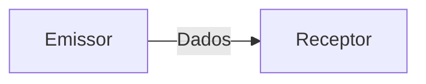

Nesse modelo, o receptor não consegue responder ao emissor através do mesmo canal de comunicação.

### 1.2 Half-duplex

Na comunicação **half-duplex**, ambos os dispositivos podem transmitir e receber dados, mas não simultaneamente.

A transmissão ocorre de maneira alternada: enquanto um dispositivo transmite, o outro recebe.

**Exemplos:**

- Rádios comunicadores (*walkie-talkies*).
- Redes Ethernet antigas que utilizavam hubs.
- Conexões Ethernet operando em half-duplex.

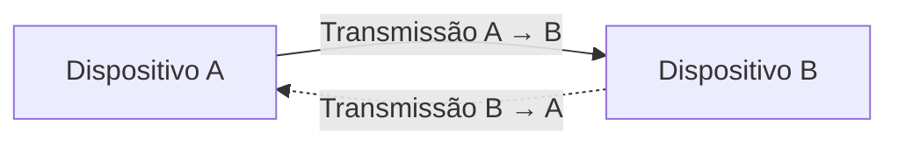

> **Importante:** As setas representam os dois sentidos possíveis de comunicação, mas as transmissões não ocorrem simultaneamente.

#### Half-duplex em redes Ethernet

Nas redes Ethernet tradicionais com hubs, os dispositivos compartilham o mesmo meio de transmissão e pertencem ao mesmo domínio de colisão.

Para controlar o acesso ao meio compartilhado, utiliza-se o mecanismo **CSMA/CD (Carrier Sense Multiple Access with Collision Detection)**. [Ver Mais](#)

Seu funcionamento básico consiste em:

1. O dispositivo verifica se o meio está disponível.
2. Se estiver livre, inicia a transmissão.
3. Se ocorrer uma colisão, a transmissão é interrompida.
4. Os dispositivos aguardam um intervalo de tempo calculado antes de tentar novamente.

Esse mecanismo era fundamental nas redes Ethernet compartilhadas, mas deixou de ser utilizado nas conexões Ethernet full-duplex modernas.

### 1.3 Full-duplex

Na comunicação **full-duplex**, os dispositivos podem transmitir e receber dados simultaneamente, sem precisar alternar o sentido da comunicação.

Esse é o modo habitual de funcionamento das conexões Ethernet modernas entre switches, servidores e outros equipamentos de rede.

**Exemplos:**

- Conexões Ethernet entre servidores e switches.
- Links entre switches Cisco Nexus.
- Conexões Ethernet entre equipamentos de armazenamento e switches.

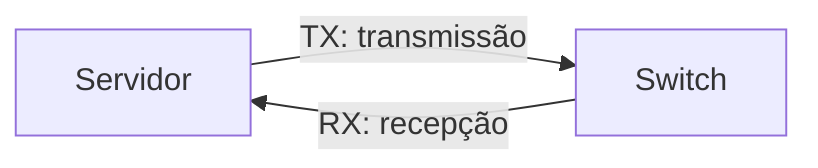

Diferentemente do half-duplex, as duas direções podem ser utilizadas ao mesmo tempo.

Em uma conexão Ethernet ponto a ponto operando em full-duplex, não existem colisões decorrentes da disputa por um meio compartilhado. Portanto, o mecanismo CSMA/CD não é utilizado.

### 1.4 Comparação dos modos de comunicação

| Característica | Simplex | Half-duplex | Full-duplex |
|---|---|---|---|
| Direção da comunicação | Unidirecional | Bidirecional | Bidirecional |
| Transmissão simultânea nos dois sentidos | Não | Não | Sim |
| Alternância entre transmissão e recepção | Não aplicável | Necessária | Desnecessária |
| Exemplo | Rádio tradicional | Walkie-talkie | Ethernet com switch |
| Colisões em Ethernet | Não aplicável | Possíveis em meio compartilhado | Não ocorrem na ligação ponto a ponto |

### 1.5 Aplicação em Data Centers

Em Data Centers modernos, as conexões Ethernet entre servidores, switches e equipamentos de armazenamento normalmente operam em **full-duplex**.

Isso permite que um dispositivo transmita e receba informações simultaneamente, aproveitando a capacidade da interface em cada direção.

#### Exemplo: interface Ethernet de 10 Gbps

Considere um servidor conectado a um switch Cisco Nexus através de uma interface Ethernet de 10 Gbps full-duplex.

Essa interface pode operar com:

- **Transmissão (TX):** até 10 Gbps.
- **Recepção (RX):** até 10 Gbps.
- **Operação simultânea:** transmissão e recepção ocorrendo ao mesmo tempo.

Portanto, é possível existir um fluxo agregado de até 20 Gbps, somando as duas direções, embora a capacidade nominal de cada direção continue sendo 10 Gbps.

> **Atenção:** Isso não significa que uma única transferência unidirecional possa atingir 20 Gbps. Além disso, a taxa útil das aplicações depende dos protocolos e dos overheads envolvidos.

#### Duplex mismatch

O **duplex mismatch** ocorre quando as duas extremidades de uma conexão Ethernet operam com configurações de duplex incompatíveis.

Por exemplo:

- Switch A configurado em full-duplex.
- Switch B configurado em half-duplex.

Essa incompatibilidade pode provocar:

- Redução significativa de desempenho.
- Colisões e colisões tardias no lado half-duplex.
- Erros e retransmissões.
- Baixa taxa de transferência, mesmo com o link ativo.

Esse problema está associado principalmente a interfaces Ethernet que suportam half-duplex, como determinadas interfaces de 10/100 Mbps.

Interfaces Ethernet modernas de alta velocidade normalmente operam exclusivamente em full-duplex.

### 1.6 Checklist de revisão

- [ ] Compreender a diferença entre simplex, half-duplex e full-duplex.
- [ ] Identificar exemplos de utilização de cada modo.
- [ ] Entender por que o CSMA/CD era necessário nas redes Ethernet compartilhadas.
- [ ] Compreender por que o CSMA/CD não é utilizado em Ethernet full-duplex.
- [ ] Diferenciar capacidade de transmissão e recepção de uma interface.
- [ ] Entender os efeitos de um duplex mismatch.


## 2. Arquitetura Hierárquica de Rede

A **arquitetura hierárquica de rede** é um modelo de projeto que organiza a infraestrutura em camadas, atribuindo funções e responsabilidades específicas a cada uma delas.

Seu principal objetivo é criar redes mais **escaláveis, resilientes, organizadas e fáceis de administrar**, evitando que todos os dispositivos e serviços sejam conectados de maneira desestruturada.

O modelo clássico de arquitetura hierárquica da Cisco é composto por três camadas:

1. **Core (Núcleo):** responsável pelo transporte rápido e confiável do tráfego.
2. **Distribution (Distribuição):** responsável pela agregação, aplicação de políticas e interconexão.
3. **Access (Acesso):** responsável pela conectividade dos dispositivos finais.

### 2.1 Visão geral da arquitetura

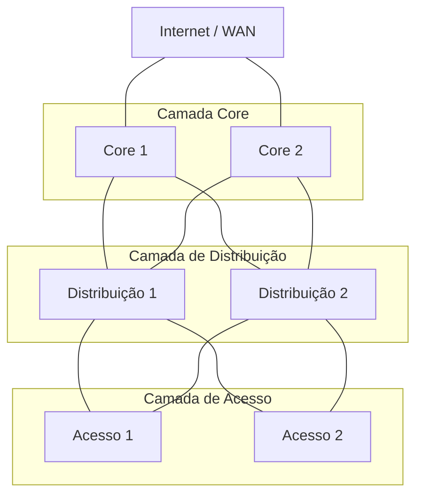


### 2.2 Camada Core (Núcleo)

A camada **Core** representa o backbone da rede, sendo responsável por interconectar os diferentes blocos de distribuição e transportar grandes volumes de tráfego.

Sua principal característica é a capacidade de realizar o encaminhamento de pacotes com **alta performance, baixa latência e elevada disponibilidade**.

#### Principais responsabilidades

- Encaminhar tráfego entre diferentes blocos da infraestrutura.
- Disponibilizar conectividade de alta velocidade.
- Oferecer caminhos redundantes para evitar pontos únicos de falha.
- Garantir convergência rápida em caso de falhas.
- Suportar o crescimento da rede sem comprometer o desempenho.

#### Características técnicas

Os equipamentos utilizados no Core normalmente possuem:

- Interfaces de alta velocidade, como 10, 25, 40, 100 ou 400 Gbps, conforme a plataforma.
- Elevada capacidade de switching e forwarding.
- Recursos de redundância de hardware e software.
- Suporte a protocolos de roteamento dinâmico.
- Capacidade de encaminhamento em hardware, utilizando ASICs.

Uma boa prática no modelo clássico é manter o Core relativamente simples, evitando políticas complexas que possam dificultar a operação e a convergência.

#### Exemplo prático

Imagine uma organização com três edifícios, cada um contendo sua própria infraestrutura de rede.

Os switches Core podem interconectar os blocos de distribuição desses edifícios, permitindo que o tráfego entre eles seja encaminhado através do backbone.

Caso um dos equipamentos Core falhe, a arquitetura pode utilizar um caminho alternativo, desde que a redundância e os protocolos estejam corretamente configurados.

### 2.3 Camada de Distribuição (Distribution)

A camada de **Distribuição** estabelece a conexão entre os switches de acesso e o Core.

Além de agregar o tráfego proveniente da camada de acesso, essa camada normalmente representa um ponto importante para aplicação de políticas e controle do tráfego.

#### Principais responsabilidades

- Agregar as conexões provenientes dos switches de acesso.
- Implementar políticas de segurança e controle de tráfego.
- Realizar roteamento entre VLANs, quando essa função estiver posicionada na distribuição.
- Aplicar mecanismos de filtragem, como ACLs.
- Implementar políticas de QoS.
- Estabelecer limites entre domínios de camada 2 e camada 3.
- Oferecer redundância para os equipamentos de acesso.

#### Tecnologias utilizadas

Dependendo do projeto, a camada de distribuição pode utilizar:

- **VLANs:** segmentação lógica da rede.
- **SVIs (Switch Virtual Interfaces):** interfaces de camada 3 associadas a VLANs.
- **HSRP/VRRP:** redundância de gateway.
- **OSPF/BGP:** roteamento dinâmico, conforme a arquitetura.
- **ACLs:** controle de tráfego entre redes.
- **Port-Channel/LACP:** agregação de links físicos.

#### Exemplo prático

Considere uma infraestrutura com três VLANs:

| VLAN | Finalidade | Rede IPv4 |
|---|---|---|
| 10 | Servidores de aplicação | 10.10.10.0/24 |
| 20 | Servidores de banco de dados | 10.10.20.0/24 |
| 30 | Gerenciamento | 10.10.30.0/24 |

Em uma arquitetura na qual os gateways estejam na distribuição, os switches dessa camada podem realizar o roteamento entre as VLANs.

Também podem aplicar ACLs para impedir que determinados servidores acessem diretamente a rede de gerenciamento.

Dessa forma, a distribuição não atua apenas como ponto de conexão, mas também como uma camada de controle.

### 2.4 Camada de Acesso (Access)

A camada de **Acesso** representa o ponto de conexão dos dispositivos finais à infraestrutura de rede.

É nessa camada que normalmente são conectados servidores, estações de trabalho, telefones IP, pontos de acesso e outros equipamentos.

Em Data Centers tradicionais, os switches de acesso também podem ser conhecidos como **Top-of-Rack (ToR)** ou **End-of-Row (EoR)**, dependendo de seu posicionamento físico.

#### Principais responsabilidades

- Disponibilizar conectividade aos dispositivos finais.
- Oferecer densidade de portas adequada.
- Associar interfaces às VLANs correspondentes.
- Implementar controles de acesso na borda.
- Aplicar políticas de QoS quando necessário.
- Fornecer redundância de conectividade aos servidores.

#### Características técnicas

A escolha dos equipamentos de acesso depende das necessidades da infraestrutura.

Em redes corporativas, podem ser importantes recursos como:

- Portas Ethernet de 1 Gbps.
- PoE para telefones IP e pontos de acesso.
- Autenticação 802.1X.
- Port Security.

Em Data Centers, os requisitos frequentemente são diferentes:

- Interfaces de 10, 25, 50 ou 100 Gbps para servidores, conforme a plataforma.
- Alta densidade de interfaces.
- Baixa latência.
- Suporte a VLANs e Port-Channels.
- Recursos de redundância, como vPC em plataformas Cisco Nexus compatíveis.

#### Exemplo prático

Considere um rack contendo 20 servidores, cada um com duas interfaces Ethernet de 10 Gbps.

Uma possibilidade é conectar cada servidor a dois switches de acesso distintos, oferecendo redundância física.

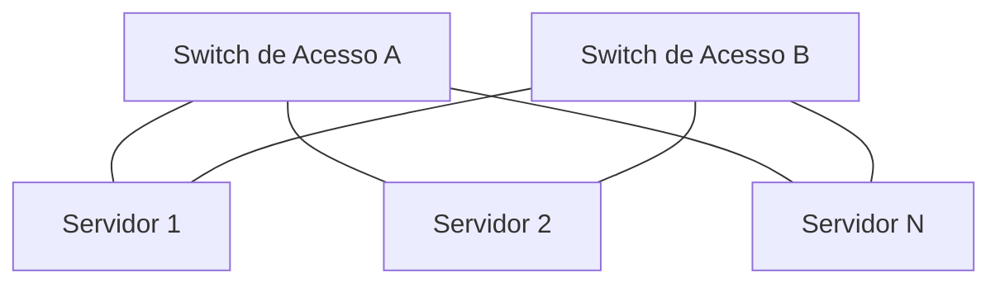

A utilização efetiva das duas conexões depende da configuração adotada, como bonding, teaming, multipathing ou Port-Channel com vPC.

> **Importante:** A existência de duas interfaces conectadas a switches distintos não garante, por si só, redundância funcional. É necessário configurar corretamente os mecanismos de failover e encaminhamento.

### 2.5 Comparação das três camadas

| Característica | Core | Distribuição | Acesso |
|---|---|---|---|
| Função principal | Transporte rápido | Agregação e políticas | Conectividade final |
| Prioridade | Performance e disponibilidade | Controle e agregação | Densidade e conectividade |
| Roteamento | Frequente | Frequente | Depende do projeto |
| ACLs e políticas | Normalmente minimizadas | Frequentemente aplicadas | Aplicadas conforme necessidade |
| Conexão típica | Outros blocos de rede | Core e acesso | Servidores e dispositivos finais |
| Exemplo de equipamento | Switch de backbone | Switch de agregação | Switch ToR ou de acesso |

### 2.6 Benefícios da arquitetura hierárquica

#### Escalabilidade

A separação em camadas permite expandir a infraestrutura de forma modular.

Por exemplo, novos switches de acesso podem ser adicionados sem exigir uma reformulação completa do Core.

#### Redundância e disponibilidade

A utilização de equipamentos e caminhos redundantes reduz a dependência de um único componente.

Entretanto, a redundância deve ser acompanhada de mecanismos adequados de prevenção de loops, roteamento e convergência.

#### Organização e modularidade

Cada camada possui responsabilidades bem definidas.

Essa separação facilita a padronização das configurações e o planejamento de mudanças.

#### Facilidade de troubleshooting

Quando ocorre uma falha, a organização hierárquica ajuda a delimitar a investigação.

Por exemplo:

- **Acesso:** verificar a interface do servidor, VLAN e estado do link.
- **Distribuição:** verificar gateways, ACLs e roteamento entre redes.
- **Core:** verificar a conectividade entre blocos e as rotas do backbone.

### 2.7 Arquitetura de duas camadas (Collapsed Core)

Nem todas as redes precisam utilizar três camadas físicas distintas.

Em ambientes menores, é comum utilizar uma arquitetura denominada **Collapsed Core**, na qual as funções de Core e Distribuição são combinadas.

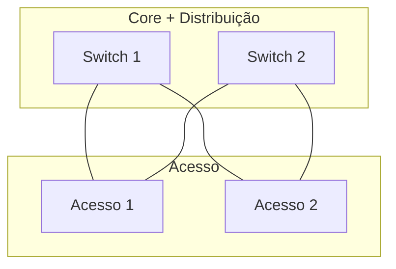

Essa abordagem pode reduzir custos e complexidade, mantendo parte dos benefícios da arquitetura hierárquica.

A decisão depende de fatores como:

- Quantidade de dispositivos.
- Volume de tráfego.
- Requisitos de disponibilidade.
- Necessidade de expansão.
- Orçamento disponível.

### 2.8 Atualização para Data Centers: Arquitetura Spine-Leaf

Embora a arquitetura hierárquica de três camadas continue importante, muitos Data Centers modernos utilizam a arquitetura **Spine-Leaf**.

Essa arquitetura é normalmente organizada em duas funções principais:

- **Spine:** switches responsáveis pela interconexão dos Leafs.
- **Leaf:** switches que conectam servidores, sistemas de armazenamento e outros dispositivos.

Em uma topologia Spine-Leaf típica, cada Leaf possui conexões com todos os Spines.


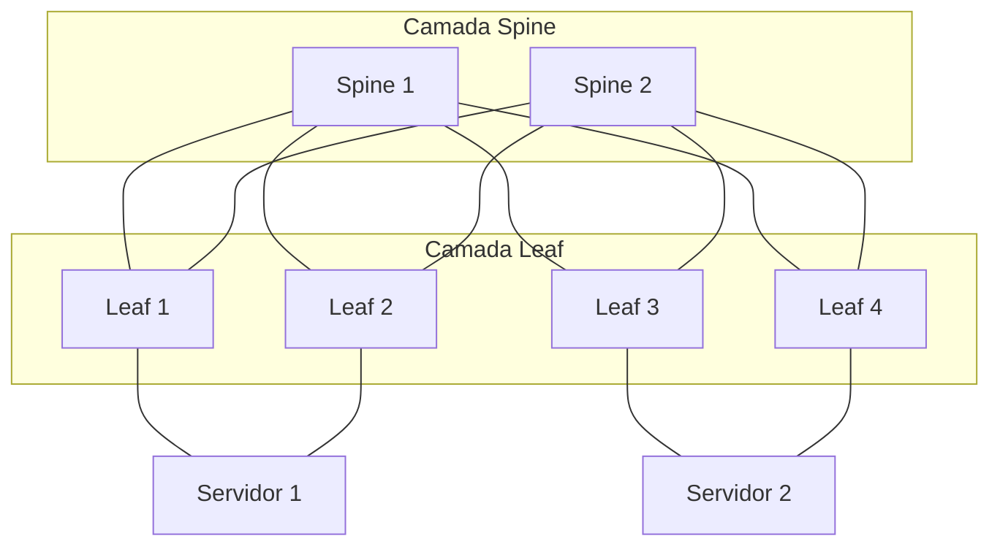

> **Nota técnica — Redundância de servidores (Single-Homed vs. Dual-Homed):**
>
> Em uma arquitetura Spine-Leaf, os servidores podem estar conectados a um único Leaf (**Single-Homed**) ou a dois Leafs distintos (**Dual-Homed**).
>
> - **Single-Homed:** o servidor possui conectividade através de um único Leaf. Caso esse switch falhe, o servidor perde a conectividade por esse caminho.
> - **Dual-Homed:** o servidor possui conexões com dois Leafs distintos, permitindo manter a conectividade em caso de falha de um deles, desde que os mecanismos de redundância estejam corretamente configurados.
>
> Em Data Centers que exigem alta disponibilidade, a conexão Dual-Homed é frequentemente utilizada. Dependendo da arquitetura, essa redundância pode ser implementada através de **vPC (Cisco Nexus), NIC Teaming/Bonding ou EVPN Multihoming**, conforme o suporte dos equipamentos.
>
> **Importante:** a arquitetura Spine-Leaf não exige obrigatoriamente que todos os servidores sejam Dual-Homed. A escolha depende dos requisitos de disponibilidade, desempenho e desenho da infraestrutura.


#### Por que utilizar Spine-Leaf?

A arquitetura foi desenvolvida para atender requisitos comuns em Data Centers, como:

- Elevado volume de tráfego entre servidores.
- Necessidade de baixa latência.
- Crescimento horizontal da infraestrutura.
- Utilização eficiente de múltiplos caminhos.
- Integração com tecnologias de virtualização e redes overlay.

#### Tráfego North-South e East-West

Em redes de Data Center, o tráfego pode ser classificado de acordo com seu sentido lógico.

**North-South:** tráfego entre os sistemas do Data Center e redes externas, como Internet, WAN ou usuários.

**East-West:** tráfego entre servidores e aplicações dentro do próprio Data Center.

Exemplo de tráfego East-West:

1. Um servidor Web recebe uma solicitação.
2. O servidor Web consulta um servidor de aplicação.
3. O servidor de aplicação consulta um banco de dados.
4. As respostas retornam pelos caminhos correspondentes.

Grande parte dessa comunicação pode ocorrer entre servidores localizados em racks diferentes.

#### ECMP (Equal-Cost Multi-Path)

Uma das vantagens de uma arquitetura Spine-Leaf com underlay de camada 3 é a possibilidade de utilizar **ECMP**.

O ECMP permite que o roteamento utilize múltiplos caminhos de mesmo custo para alcançar determinado destino.

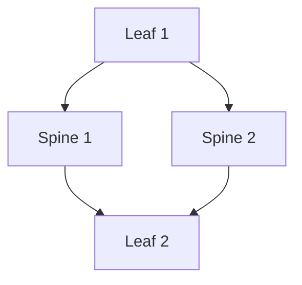

Nesse exemplo, o Leaf 1 possui dois caminhos de mesmo custo para alcançar o Leaf 2.

O equipamento pode distribuir fluxos entre esses caminhos, normalmente utilizando um cálculo de hash baseado em campos dos pacotes.

> **Atenção:** ECMP não significa necessariamente dividir cada pacote individualmente entre os caminhos. A distribuição por fluxo é utilizada com frequência para evitar reordenação de pacotes.

### 2.9 Arquitetura hierárquica vs. Spine-Leaf

| Característica | Hierárquica tradicional | Spine-Leaf |
|---|---|---|
| Organização | Core, Distribuição e Acesso | Spine e Leaf |
| Objetivo original | Modularidade e segmentação funcional | Escalabilidade e conectividade de Data Center |
| Caminhos redundantes | Dependem do projeto | Múltiplos caminhos entre Leafs |
| Tráfego East-West | Pode exigir passagem por camadas de agregação | Normalmente percorre Leaf-Spine-Leaf |
| Escalabilidade | Expansão por blocos hierárquicos | Expansão horizontal de Leafs e Spines |
| Tecnologias comuns | STP, VLAN, HSRP, roteamento | ECMP, BGP, VXLAN EVPN |
| Aplicação | Redes corporativas e Data Centers tradicionais | Data Centers modernos |

> **Nota técnica:** Spine-Leaf não é simplesmente uma mudança de nomes das camadas tradicionais. Trata-se de uma arquitetura com características próprias de conectividade e escalabilidade.

### 2.10 Relação com o CCNP DCCOR 350-601

O conhecimento dessas arquiteturas é fundamental para compreender os seguintes tópicos do DCCOR:

- **Cisco Nexus:** funções dos switches em diferentes arquiteturas de Data Center.
- **vPC:** redundância e conectividade de dispositivos a switches Nexus.
- **OSPF e BGP:** protocolos de roteamento utilizados na infraestrutura.
- **ECMP:** utilização de múltiplos caminhos de mesmo custo.
- **VXLAN EVPN:** construção de redes overlay sobre um underlay IP.
- **Cisco ACI:** arquitetura baseada em switches Spine e Leaf.
- **Data Center Design:** requisitos de disponibilidade, escalabilidade e desempenho.

É importante compreender tanto a arquitetura tradicional quanto o Spine-Leaf, pois ambas ajudam a explicar a evolução das redes de Data Center.

### 2.11 Checklist de revisão

- [ ] Compreender o objetivo de uma arquitetura hierárquica.
- [ ] Identificar as responsabilidades das camadas Core, Distribuição e Acesso.
- [ ] Entender a função da camada de Distribuição na aplicação de políticas.
- [ ] Compreender a importância da redundância entre as camadas.
- [ ] Diferenciar a arquitetura de três camadas do Collapsed Core.
- [ ] Compreender as funções dos switches Spine e Leaf.
- [ ] Diferenciar tráfego North-South e East-West.
- [ ] Entender o funcionamento básico do ECMP.
- [ ] Relacionar Spine-Leaf com BGP, VXLAN EVPN e Cisco ACI.


## 3. Modelo OSI (Open Systems Interconnection)

O **modelo OSI (Open Systems Interconnection)** é um modelo de referência desenvolvido pela **ISO (International Organization for Standardization)** para representar e padronizar as funções envolvidas na comunicação entre sistemas de rede.

Seu principal objetivo é dividir o processo de comunicação em camadas, permitindo compreender como os dados são preparados, transmitidos, encaminhados e recebidos.

O modelo OSI possui **sete camadas**, cada uma com responsabilidades específicas.

### 3.1 Por que utilizar um modelo em camadas?

Antes da padronização dos protocolos de comunicação, diferentes fabricantes utilizavam tecnologias e arquiteturas proprietárias, dificultando a interoperabilidade entre equipamentos.

A organização em camadas oferece diversas vantagens:

- **Padronização:** facilita a comunicação entre tecnologias e fabricantes diferentes.
- **Modularidade:** permite desenvolver ou modificar protocolos sem redesenhar toda a arquitetura.
- **Interoperabilidade:** estabelece funções e interfaces que ajudam diferentes sistemas a trabalhar em conjunto.
- **Troubleshooting:** facilita a identificação da origem de problemas de comunicação.
- **Abstração:** permite estudar cada etapa da comunicação separadamente.

> **Nota técnica:** O modelo OSI é uma referência conceitual. As redes modernas utilizam principalmente protocolos da arquitetura TCP/IP, que não correspondem perfeitamente às sete camadas do OSI.

### 3.2 As sete camadas do modelo OSI

O modelo é organizado da camada 1 (Física) até a camada 7 (Aplicação).

| Camada | Nome | Função principal | Exemplos |
|---|---|---|---|
| 7 | Aplicação | Serviços de rede utilizados pelas aplicações | HTTP, DNS, SMTP |
| 6 | Apresentação | Representação, codificação e transformação dos dados | UTF-8, formatos de dados, criptografia |
| 5 | Sessão | Organização e controle de sessões de comunicação | Estabelecimento e controle lógico de sessões |
| 4 | Transporte | Comunicação fim a fim e multiplexação por portas | TCP, UDP |
| 3 | Rede | Endereçamento lógico e encaminhamento entre redes | IPv4, IPv6, ICMP |
| 2 | Enlace de Dados | Comunicação no enlace local e enquadramento | Ethernet, endereços MAC, VLANs |
| 1 | Física | Transmissão de sinais pelo meio físico | Cabos, fibra óptica, sinais elétricos e ópticos |

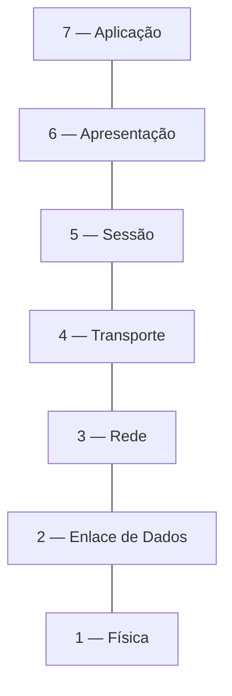

| Camadas | PDU usual |
| --- | --- |
| 7–5 | Dados |
| 4 | Segmento (TCP) ou datagrama (UDP) |
| 3 | Pacote |
| 2 | Quadro (*frame*) |
| 1 | Bits |

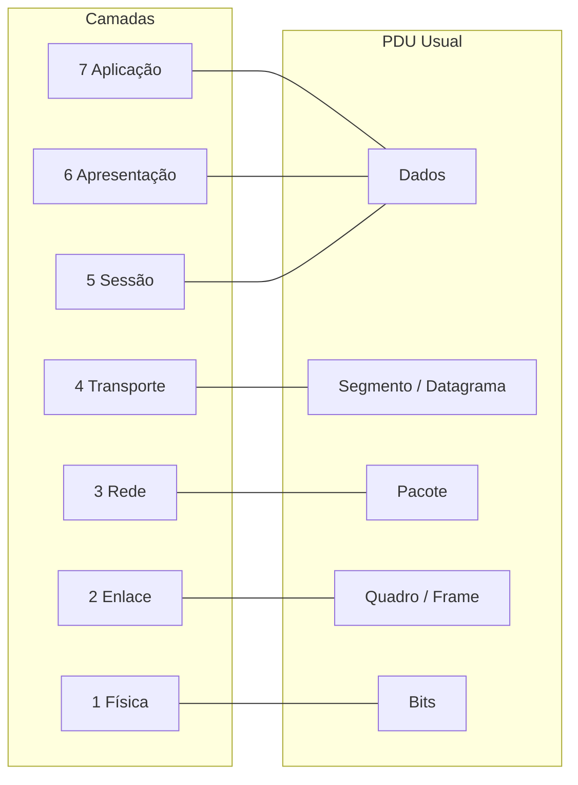

> **Observação:** essas associações são didáticas; a terminologia pode variar conforme o protocolo e o contexto.

### 3.3 Camada 1 — Física (Physical Layer)

A camada Física é responsável pela transmissão e recepção de **bits através de um meio físico**.

Ela define características necessárias para representar os bits por sinais elétricos, ópticos ou de rádio.

#### Principais responsabilidades

- Representação dos bits por sinais.
- Características elétricas e ópticas da transmissão.
- Taxas de sinalização e sincronização.
- Especificações de conectores e meios físicos.
- Características físicas do enlace.

#### Exemplos práticos

Em um Data Center, um servidor pode estar conectado a um Cisco Nexus por meio de um cabo DAC ou de uma conexão óptica com transceptores SFP+/SFP28.

A camada Física está relacionada à transmissão dos sinais entre as interfaces.

Problemas típicos incluem:

- Cabo danificado.
- Transceptor incompatível ou defeituoso.
- Potência óptica fora dos limites suportados.
- Falta de sinal ou ausência de link.
- Erros físicos de transmissão.

> **Importante:** A camada Física não interpreta endereços IP nem decide para qual rede encaminhar um pacote.

### 3.4 Camada 2 — Enlace de Dados (Data Link Layer)

A camada de Enlace é responsável pela comunicação através de um enlace de dados, incluindo a organização das informações em **quadros (frames)**.

Em redes Ethernet, essa camada utiliza endereços MAC e mecanismos de identificação do tipo de conteúdo transportado.

#### Principais responsabilidades

- Formação e interpretação de quadros.
- Endereçamento MAC.
- Detecção de erros através de mecanismos como o FCS.
- Identificação do protocolo transportado.
- Comutação Ethernet.
- Segmentação lógica através de VLANs.

#### Exemplo prático

Considere dois servidores conectados ao mesmo switch e pertencentes à mesma VLAN.

O switch pode encaminhar os quadros Ethernet utilizando sua tabela de endereços MAC, sem precisar realizar roteamento IP entre os servidores.

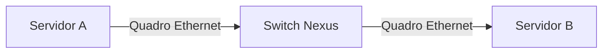

#### MAC Address Table

Um switch Ethernet aprende endereços MAC de origem associados às interfaces e VLANs pelas quais os quadros são recebidos.

Quando conhece o endereço MAC de destino, pode encaminhar o quadro pela interface correspondente.

Quando o destino é desconhecido, normalmente realiza flooding dentro do domínio de camada 2 aplicável.

#### Tecnologias relacionadas

- IEEE 802.3 — Ethernet.
- IEEE 802.1Q — VLAN tagging.
- STP — Spanning Tree Protocol.
- LACP — Link Aggregation Control Protocol.


### 3.5 Camada 3 — Rede (Network Layer)

A camada de Rede é responsável pelo **endereçamento lógico e encaminhamento de pacotes entre redes diferentes**.

Enquanto a camada 2 trabalha com quadros no enlace, a camada 3 permite a comunicação entre redes IP.

#### Principais responsabilidades

- Endereçamento lógico.
- Encaminhamento de pacotes.
- Seleção de caminhos através de informações de roteamento.
- Controle de TTL no IPv4 e Hop Limit no IPv6.
- Tratamento de informações de rede necessárias à entrega dos pacotes.

#### Exemplo prático

Considere dois servidores em sub-redes distintas:

| Dispositivo | Endereço IP |
|---|---|
| Servidor A | 10.10.10.10/24 |
| Servidor B | 10.10.20.10/24 |

Como pertencem a redes diferentes, a comunicação normalmente precisa passar por um dispositivo que realize roteamento, como um switch de camada 3.

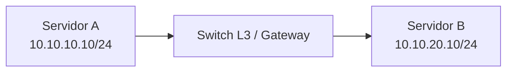

O dispositivo de camada 3 consulta as informações de encaminhamento para determinar a próxima etapa do caminho até a rede de destino.

#### Tecnologias relacionadas

- IPv4 e IPv6.
- ICMP.
- OSPF e BGP, como protocolos de roteamento que fornecem informações para o encaminhamento IP.
- ECMP.
- Roteamento inter-VLAN.

> **Nota técnica:** Protocolos como OSPF e BGP não devem ser confundidos com o próprio encaminhamento de pacotes IP. Eles participam da construção e distribuição de informações de roteamento.

### 3.6 Camada 4 — Transporte (Transport Layer)

A camada de Transporte oferece mecanismos para a comunicação entre processos nas extremidades da rede.

No conjunto de protocolos TCP/IP, os principais protocolos de transporte são **TCP e UDP**.

#### Principais responsabilidades

- Identificação de aplicações através de portas.
- Multiplexação de diferentes comunicações.
- Segmentação de dados, conforme o protocolo.
- Controle de fluxo, quando suportado.
- Confiabilidade e retransmissão, quando suportadas.

#### TCP (Transmission Control Protocol)

O TCP é orientado à conexão e oferece entrega confiável e ordenada de um fluxo de bytes.

Entre seus mecanismos estão:

- Estabelecimento de conexão.
- Números de sequência.
- Confirmações de recebimento.
- Retransmissões.
- Controle de fluxo.
- Controle de congestionamento.

#### UDP (User Datagram Protocol)

O UDP é um protocolo de transporte sem conexão que oferece um serviço de datagramas com menor quantidade de mecanismos.

Ele não implementa, por si só, confirmação de entrega, retransmissão ou ordenação.

Isso não impede que aplicações construídas sobre UDP implementem mecanismos próprios de confiabilidade.

#### Exemplos

| Aplicação ou protocolo | Transporte comum |
|---|---|
| HTTPS tradicional | TCP 443 |
| DNS | UDP 53 ou TCP 53 |
| SSH | TCP 22 |
| NTP | UDP 123 |
| QUIC / HTTP/3 | UDP, normalmente porta 443 |

> **Importante:** A escolha entre TCP e UDP não depende apenas de velocidade. Também envolve requisitos de confiabilidade, latência, controle de congestionamento e comportamento da aplicação.

### 3.7 Camada 5 — Sessão (Session Layer)

A camada de Sessão representa funções relacionadas ao estabelecimento, manutenção, organização e encerramento de sessões lógicas de comunicação entre aplicações.

Entre os conceitos associados a essa camada estão:

- Controle do diálogo entre aplicações.
- Gerenciamento do estado de sessões.
- Sincronização de operações.
- Recuperação de determinados estados de comunicação.

#### Exemplo conceitual

Uma aplicação cliente estabelece uma sessão com um serviço remoto e mantém informações necessárias para continuar a interação ao longo de várias operações.


### 3.8 Camada 6 — Apresentação (Presentation Layer)

A camada de Apresentação representa funções responsáveis pela forma como os dados são codificados, interpretados e transformados para serem compreendidos pelas aplicações.

#### Principais responsabilidades

- Conversão de formatos de dados.
- Codificação de caracteres.
- Serialização e representação de informações.
- Compressão e descompressão.
- Transformações criptográficas, dependendo da arquitetura.

#### Exemplos

- UTF-8 para representação de caracteres.
- JSON e XML como formatos de representação de dados.
- Codificações utilizadas na transmissão de imagens e outros conteúdos.

### 3.9 Camada 7 — Aplicação (Application Layer)

A camada de Aplicação representa os protocolos e serviços que permitem às aplicações utilizar a rede.

Ela não deve ser confundida com a interface gráfica de um programa.

Por exemplo, um navegador é uma aplicação, enquanto HTTP é um protocolo utilizado por ele para comunicar-se com servidores Web.

#### Principais responsabilidades

- Disponibilizar serviços de comunicação para aplicações.
- Definir mensagens e operações específicas de protocolos.
- Permitir acesso a serviços como Web, resolução de nomes e transferência de arquivos.

#### Exemplos

| Protocolo | Finalidade |
|---|---|
| HTTP/HTTPS | Comunicação Web |
| DNS | Resolução de nomes |
| SMTP | Envio de mensagens de e-mail |
| SSH | Acesso remoto seguro |
| DHCP | Configuração automática de parâmetros de rede |
| SNMP | Monitoramento e gerenciamento de dispositivos |

#### Exemplo prático

Quando um administrador acessa a interface de gerenciamento de um equipamento Cisco através de HTTPS, o protocolo HTTP e os mecanismos de segurança associados permitem a comunicação entre o cliente e o serviço Web do equipamento.

### 3.10 Equipamentos e sua relação com o modelo OSI

É comum associar determinados equipamentos a camadas específicas do modelo OSI.

Essa associação é útil para fins didáticos, mas não significa que o equipamento opere exclusivamente naquela camada.

| Equipamento | Camadas mais associadas | Função |
|---|---|---|
| Repetidor | 1 | Regeneração ou repetição de sinais |
| Hub Ethernet | 1 | Repetição de sinais entre portas |
| Switch Ethernet L2 | 1 e 2 | Comutação baseada em quadros e MAC |
| Roteador | 1, 2 e 3 | Encaminhamento entre redes |
| Switch multicamada | 1, 2 e 3 ou superiores | Comutação e roteamento |
| Firewall | Variável | Filtragem e aplicação de políticas |
| Load Balancer | Frequentemente 4 e/ou 7 | Distribuição de conexões ou requisições |

Em Data Centers, um Cisco Nexus pode executar funções de switching Ethernet, roteamento IP e recursos adicionais de encapsulamento, dependendo do modelo e da configuração.

### 3.11 Aplicação do modelo OSI no troubleshooting

Uma das maiores utilidades práticas do modelo OSI é ajudar a organizar o diagnóstico de falhas.

Considere um servidor que não consegue acessar uma aplicação hospedada em outra rede.

A investigação pode ser organizada da seguinte forma:

| Camada | O que verificar |
|---|---|
| 1 — Física | Estado do link, cabos, transceptores, erros físicos |
| 2 — Enlace | VLAN, trunk, MAC address table, STP |
| 3 — Rede | Endereços IP, máscaras, gateway, rotas |
| 4 — Transporte | Portas TCP/UDP, sessões, bloqueios |
| 5 — Sessão | Estado e continuidade da sessão lógica |
| 6 — Apresentação | Codificação, formatos e negociação criptográfica |
| 7 — Aplicação | Serviço ativo, DNS, HTTP, autenticação e logs |

#### Exemplos de comandos Cisco NX-OS

Verificar o estado das interfaces:

```bash
show interface status
```

Consultar informações de uma interface:

```bash
show interface ethernet 1/1
```

Consultar a tabela MAC:

```bash
show mac address-table
```

Verificar VLANs:

```bash
show vlan brief
```

Consultar rotas IPv4:

```bash
show ip route
```

Verificar a tabela ARP:

```bash
show ip arp
```

### 3.12 Relação com o CCNP DCCOR 350-601

O modelo OSI fornece a base conceitual para diversos assuntos do DCCOR:

- **Camada 1:** interfaces Ethernet, cabos DAC, transceptores e conectividade física.
- **Camada 2:** VLANs, trunks, STP, Port-Channel e vPC.
- **Camada 3:** roteamento IP, OSPF, BGP e ECMP.
- **Camada 4:** protocolos de transporte utilizados por aplicações e serviços.
- **Camadas 5 a 7:** serviços de aplicação, automação, APIs e protocolos de gerenciamento.

Também é importante para compreender tecnologias que combinam diferentes funções, como **VXLAN**, que encapsula quadros Ethernet para transportá-los através de uma rede IP.

### 3.13 Checklist de revisão

- [ ] Compreender a finalidade do modelo OSI.
- [ ] Memorizar as sete camadas na ordem correta.
- [ ] Identificar as principais responsabilidades de cada camada.
- [ ] Diferenciar quadros Ethernet, pacotes IP e segmentos TCP.
- [ ] Entender a diferença entre endereçamento MAC e IP.
- [ ] Compreender as diferenças fundamentais entre TCP e UDP.
- [ ] Identificar protocolos associados à camada de Aplicação.
- [ ] Entender que as camadas 5 e 6 são abstrações conceituais no contexto TCP/IP.
- [ ] Relacionar as camadas com funções dos switches Cisco Nexus.
- [ ] Utilizar o modelo OSI para organizar o troubleshooting de redes.


## 4. Modelo TCP/IP e relação com o OSI

O **modelo TCP/IP (Transmission Control Protocol / Internet Protocol)** é uma arquitetura de protocolos utilizada como base para a comunicação nas redes modernas, incluindo redes corporativas, Data Centers e a Internet.

Diferentemente do modelo OSI, que foi desenvolvido como um modelo de referência conceitual, o TCP/IP representa uma arquitetura construída em torno de protocolos efetivamente utilizados na comunicação entre sistemas.

O nome TCP/IP deriva de dois protocolos fundamentais:

- **TCP (Transmission Control Protocol):** protocolo de transporte que oferece comunicação confiável e orientada à conexão.
- **IP (Internet Protocol):** protocolo responsável pelo endereçamento lógico e encaminhamento de pacotes entre redes.

Entretanto, a arquitetura TCP/IP não se limita a esses dois protocolos. Ela compreende diversos outros, como UDP, ICMP, DNS, HTTP, SSH e DHCP.

### 4.1 Organização do modelo TCP/IP

O modelo TCP/IP é apresentado com quatro camadas:

1. **Aplicação (Application)**
2. **Host-to-Host / Transporte (Transport)**
3. **Internet**
4. **Network Access / Acesso à Rede**

Cada camada possui responsabilidades específicas e utiliza os serviços oferecidos pela camada inferior.

| Camada TCP/IP | Função principal | Exemplos de protocolos e tecnologias |
|---|---|---|
| Aplicação | Disponibilizar serviços de comunicação às aplicações | HTTP, DNS, SSH, SMTP, DHCP |
| Host-to-Host / Transporte | Comunicação entre processos, portas e mecanismos de transporte | TCP, UDP |
| Internet | Endereçamento lógico e encaminhamento entre redes | IPv4, IPv6, ICMP |
| Network Access / Acesso à Rede | Comunicação pelo enlace e transmissão física | Ethernet, IEEE 802.1Q, fibra óptica |

> **Nota técnica:** Também existem representações didáticas do TCP/IP com cinco camadas, separando Enlace de Dados e Física. Neste material, utilizaremos o modelo de quatro camadas.

### 4.2 Camada de Aplicação (Application Layer)

A camada de Aplicação representa os protocolos e serviços que permitem às aplicações comunicar-se através da rede.

No modelo TCP/IP, essa camada reúne funções que, no modelo OSI, são associadas às camadas de Aplicação, Apresentação e Sessão.

Isso significa que funções como representação de dados, gerenciamento de sessões e comunicação entre aplicações podem ser implementadas diretamente pelos protocolos de aplicação ou por bibliotecas e mecanismos complementares.

#### Principais responsabilidades

- Disponibilizar serviços de rede às aplicações.
- Definir formatos e operações de protocolos de aplicação.
- Permitir resolução de nomes e acesso a serviços.
- Implementar mecanismos de autenticação e gerenciamento de sessões, quando necessários.
- Utilizar mecanismos de codificação e proteção dos dados, conforme o protocolo.

#### Exemplos de protocolos

| Protocolo | Finalidade | Transporte habitual |
|---|---|---|
| HTTP | Comunicação Web | TCP |
| HTTPS (HTTP/1.1 ou HTTP/2) | Comunicação Web protegida por TLS | TCP |
| HTTP/3 | Comunicação Web utilizando QUIC | UDP |
| DNS | Resolução de nomes | UDP ou TCP |
| SSH | Acesso remoto seguro | TCP |
| SMTP | Envio de e-mails | TCP |
| DHCPv4 | Configuração automática de rede | UDP |
| SNMP | Gerenciamento e monitoramento | Normalmente UDP |

#### Exemplo prático

Considere um administrador acessando a interface Web de um switch Cisco Nexus através de HTTPS.

A aplicação cliente estabelece uma comunicação com o serviço Web do equipamento, utilizando os protocolos necessários para transportar e proteger as informações.

A camada de Aplicação define como as mensagens são interpretadas pelo cliente e pelo servidor.

### 4.3 Camada Host-to-Host / Transporte (Transport Layer)

A camada **Host-to-Host**, também denominada **Transporte**, é responsável por oferecer serviços de comunicação entre processos executados em dispositivos diferentes.

Ela permite que múltiplas aplicações utilizem simultaneamente a rede, diferenciando as comunicações através de identificadores como as portas TCP e UDP.

#### Principais responsabilidades

- Identificação de processos através de portas.
- Multiplexação e demultiplexação de comunicações.
- Segmentação ou organização dos dados para transporte.
- Controle de fluxo, conforme o protocolo.
- Entrega confiável e ordenada, quando implementada.
- Controle de congestionamento, quando implementado.

Os dois protocolos de transporte mais conhecidos são TCP e UDP.

#### TCP (Transmission Control Protocol)

O TCP oferece um serviço orientado à conexão, com entrega confiável e ordenada de um fluxo de bytes.

Entre seus mecanismos estão:

- Estabelecimento de conexão através do *three-way handshake*.
- Números de sequência.
- Confirmações de recebimento (*ACK*).
- Retransmissões.
- Controle de fluxo.
- Controle de congestionamento.

**Exemplo:** uma conexão SSH entre um computador e um servidor utiliza TCP para transportar os dados da sessão.

#### UDP (User Datagram Protocol)

O UDP oferece um serviço de datagramas sem estabelecimento de conexão no próprio protocolo.

Ele possui um cabeçalho mais simples e não implementa nativamente confirmação de entrega, retransmissão ou ordenação.

**Exemplos:** consultas DNS tradicionais, NTP e determinados protocolos de streaming e comunicação em tempo real.

> **Nota técnica:** O uso de UDP não significa necessariamente que uma aplicação não possa oferecer confiabilidade. Protocolos construídos sobre UDP, como QUIC, podem implementar seus próprios mecanismos de controle e recuperação.

#### Portas de origem e destino

Uma comunicação TCP ou UDP utiliza números de portas para identificar os processos envolvidos.

Por exemplo, em uma conexão SSH:

| Campo | Exemplo |
|---|---|
| IP de origem | 192.168.10.100 |
| Porta de origem | 51000 |
| IP de destino | 192.168.20.10 |
| Porta de destino | 22 |
| Protocolo | TCP |

A porta de origem normalmente é escolhida pelo sistema operacional cliente, enquanto a porta de destino identifica o serviço SSH.

### 4.4 Camada Internet (Internet Layer)

A camada Internet é responsável pelo **endereçamento lógico e pela entrega de pacotes através de diferentes redes IP**.

Essa camada corresponde aproximadamente à camada de Rede do modelo OSI.

Sua principal função é permitir que dispositivos localizados em redes diferentes possam comunicar-se por meio de roteadores e switches de camada 3.

#### Principais responsabilidades

- Endereçamento lógico utilizando IPv4 ou IPv6.
- Encaminhamento de pacotes entre redes.
- Identificação da origem e do destino IP.
- Utilização de informações de roteamento.
- Controle do tempo de vida dos pacotes através de TTL ou Hop Limit.
- Sinalização de erros e diagnósticos através de ICMP.

#### Principais protocolos

- **IPv4:** endereçamento e encaminhamento utilizando endereços de 32 bits.
- **IPv6:** endereçamento e encaminhamento utilizando endereços de 128 bits.
- **ICMP/ICMPv6:** mensagens de controle, diagnóstico e sinalização.

#### Exemplo prático

Considere dois servidores em redes distintas:

| Dispositivo | Endereço IP |
|---|---|
| Servidor A | 10.10.10.10/24 |
| Servidor B | 10.10.20.10/24 |

Para que o Servidor A se comunique com o Servidor B, é necessário existir conectividade de camada 3 entre as duas redes.

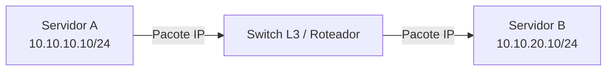

O equipamento de camada 3 consulta sua tabela de encaminhamento para determinar por qual interface o pacote deverá seguir.

O endereço IP de destino normalmente permanece o mesmo ao longo do caminho, enquanto o encapsulamento de camada 2 pode ser reconstruído a cada salto.

### 4.5 Camada Network Access / Acesso à Rede

A camada de **Acesso à Rede (Network Access)** representa as funções necessárias para transportar os dados através de um enlace de comunicação.

Ela reúne responsabilidades que, no modelo OSI, são divididas entre:

- **Camada 2 — Enlace de Dados**
- **Camada 1 — Física**

Essa camada abrange tanto a organização dos dados em quadros quanto sua transmissão através do meio físico.

#### Principais responsabilidades

- Encapsulamento em quadros.
- Endereçamento físico, quando utilizado pela tecnologia.
- Controle de acesso ao meio.
- Detecção de erros no enlace.
- Transmissão de sinais elétricos, ópticos ou de rádio.
- Definição das características físicas da comunicação.

#### Exemplos de tecnologias

- Ethernet (IEEE 802.3).
- VLAN tagging (IEEE 802.1Q).
- Interfaces de fibra óptica.
- Cabos DAC.
- Interfaces Ethernet de cobre.
- Tecnologias de enlace utilizadas em diferentes meios físicos.

#### Exemplo prático

Um servidor conectado a um switch Cisco Nexus através de uma interface Ethernet de 25 Gbps utiliza a camada de Acesso à Rede para transmitir quadros através do enlace físico.

O switch interpreta as informações Ethernet necessárias ao encaminhamento e transmite os quadros pelas interfaces apropriadas.

> **Importante:** A camada de Acesso à Rede não define, por si só, o caminho completo entre redes IP distintas. Essa responsabilidade está relacionada à camada Internet.

### 4.6 Relação entre os modelos TCP/IP e OSI

Embora ambos utilizem uma organização em camadas, o modelo OSI e a arquitetura TCP/IP possuem estruturas diferentes.

O modelo OSI divide a comunicação em sete camadas, enquanto o modelo TCP/IP apresentado neste material utiliza quatro.

| TCP/IP | Correspondência aproximada no OSI |
|---|---|
| Aplicação | Aplicação, Apresentação e Sessão (7, 6 e 5) |
| Host-to-Host / Transporte | Transporte (4) |
| Internet | Rede (3) |
| Network Access / Acesso à Rede | Enlace e Física (2 e 1) |

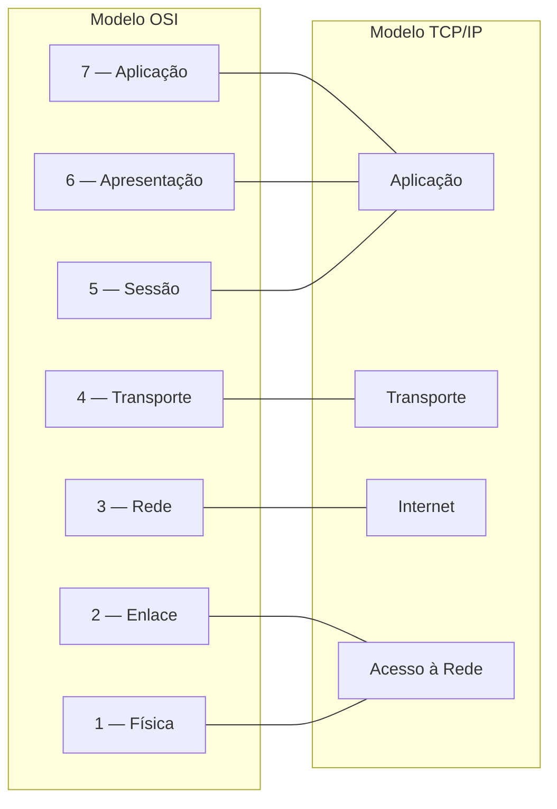

> **Nota:** O mapeamento é conceitual, não uma equivalência exata entre as arquiteturas. Também existem representações didáticas do TCP/IP com cinco camadas, separando Enlace e Física.

#### Principais diferenças

| Característica | Modelo OSI | Modelo TCP/IP |
|---|---|---|
| Organização | Sete camadas | Quatro camadas nesta representação |
| Natureza | Modelo de referência conceitual | Arquitetura de protocolos |
| Aplicação prática | Estudo, padronização e troubleshooting | Base das redes IP modernas |
| Sessão e Apresentação | Camadas independentes | Funções integradas à camada de Aplicação |
| Enlace e Física | Camadas independentes | Agrupadas em Acesso à Rede |

### 4.7 Exemplo de comunicação utilizando TCP/IP

Considere um administrador acessando um servidor Web através de HTTPS sobre TCP.

O processo pode ser representado da seguinte forma:

1. **Aplicação:** o cliente prepara uma mensagem HTTP.
2. **Transporte:** o TCP transporta os dados da aplicação, utilizando portas de origem e destino.
3. **Internet:** o IP adiciona informações de endereçamento lógico e permite o encaminhamento entre redes.
4. **Acesso à Rede:** o pacote IP é encapsulado em um quadro Ethernet e transmitido pelo enlace físico.

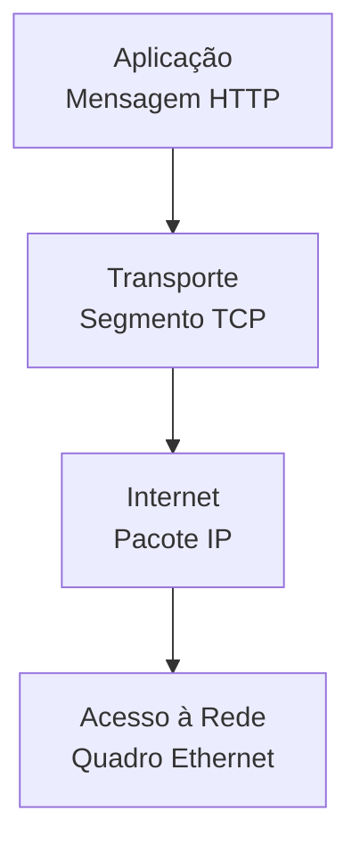

No dispositivo de destino, ocorre o processo inverso, no qual os dados são entregues progressivamente às camadas superiores até alcançarem a aplicação.

Esse processo é denominado **encapsulamento e desencapsulamento** e será detalhado na próxima seção.

### 4.8 Aplicação do modelo TCP/IP em Data Centers

A arquitetura TCP/IP está presente em praticamente todos os componentes de comunicação de um Data Center moderno.

#### Servidores e aplicações

Aplicações utilizam protocolos de transporte e serviços de aplicação para comunicar-se com outros sistemas.

Exemplos:

- Servidores Web utilizando HTTP/HTTPS.
- Bancos de dados utilizando conexões TCP.
- Serviços de resolução de nomes utilizando DNS.
- Serviços de gerenciamento utilizando SSH e APIs.

#### Infraestrutura de rede

Switches Cisco Nexus e outros equipamentos utilizam protocolos IP para encaminhamento, gerenciamento e comunicação com serviços de infraestrutura.

#### Redes Spine-Leaf

Em arquiteturas Spine-Leaf com underlay IP, a camada Internet permite o encaminhamento de pacotes entre os switches.

Protocolos de roteamento como OSPF ou BGP podem ser utilizados para distribuir informações de alcance entre os equipamentos.

#### VXLAN

O VXLAN permite transportar quadros Ethernet através de uma rede IP utilizando encapsulamento UDP.

Isso demonstra como diferentes funções da arquitetura TCP/IP podem ser combinadas para implementar tecnologias de virtualização de redes.

> **Nota técnica:** O funcionamento detalhado do VXLAN, incluindo VTEPs, VNIs, underlay e overlay, será abordado nos módulos específicos do DCCOR.

### 4.9 Relação com o CCNP DCCOR 350-601

O modelo TCP/IP é essencial para compreender:

- **IPv4 e IPv6:** endereçamento lógico e conectividade.
- **OSPF e BGP:** distribuição de informações de roteamento.
- **ECMP:** utilização de múltiplos caminhos IP de mesmo custo.
- **VXLAN EVPN:** encapsulamento e distribuição de informações de alcance.
- **Cisco ACI:** comunicação e políticas em uma fabric de Data Center.
- **Automação:** APIs REST, HTTPS, SSH e protocolos de gerenciamento.
- **Troubleshooting:** identificação de falhas entre as diferentes funções da comunicação.

### 4.10 Checklist de revisão

- [ ] Compreender a finalidade da arquitetura TCP/IP.
- [ ] Identificar as quatro camadas apresentadas no DCICN 640-911.
- [ ] Diferenciar o modelo TCP/IP do modelo OSI.
- [ ] Entender as responsabilidades da camada de Aplicação.
- [ ] Compreender a função dos protocolos TCP e UDP.
- [ ] Entender o papel do IP no encaminhamento entre redes.
- [ ] Identificar as funções da camada de Acesso à Rede.
- [ ] Relacionar as camadas TCP/IP com as camadas OSI.
- [ ] Compreender a comunicação básica entre cliente e servidor.
- [ ] Relacionar TCP/IP às tecnologias utilizadas em Data Centers.
