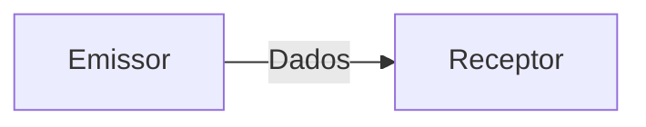
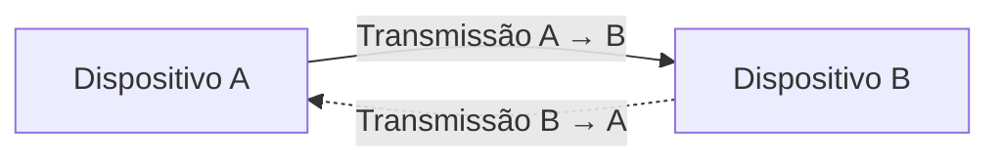
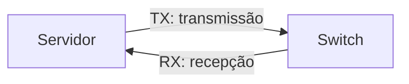
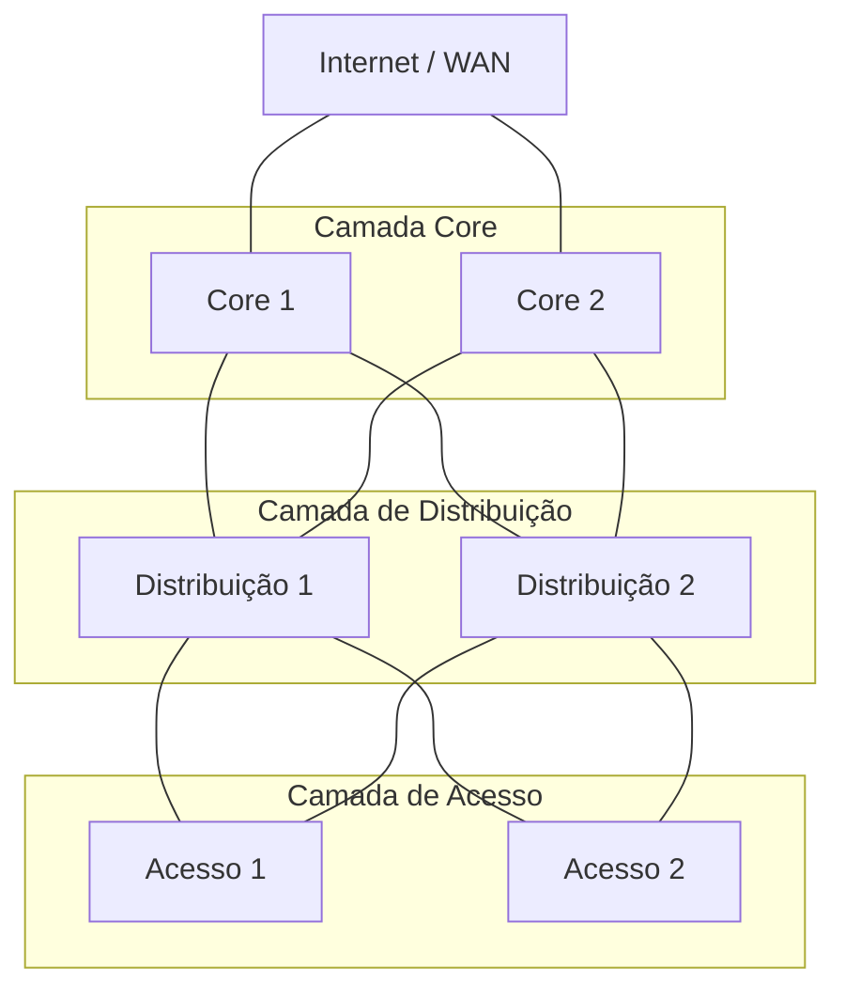
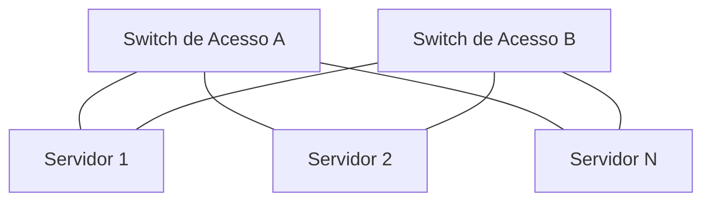
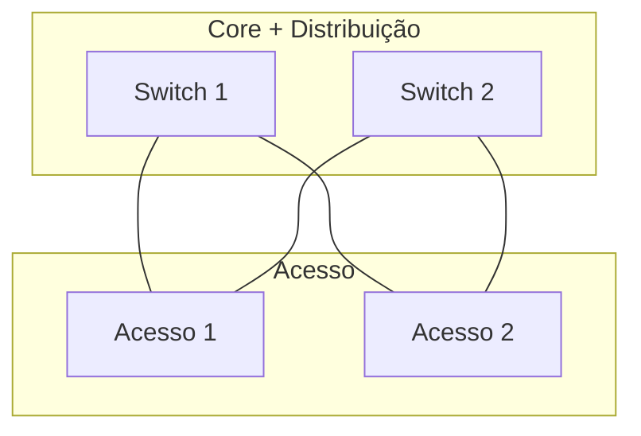
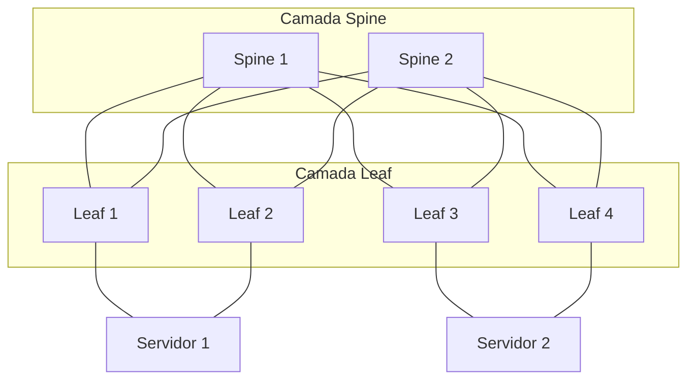
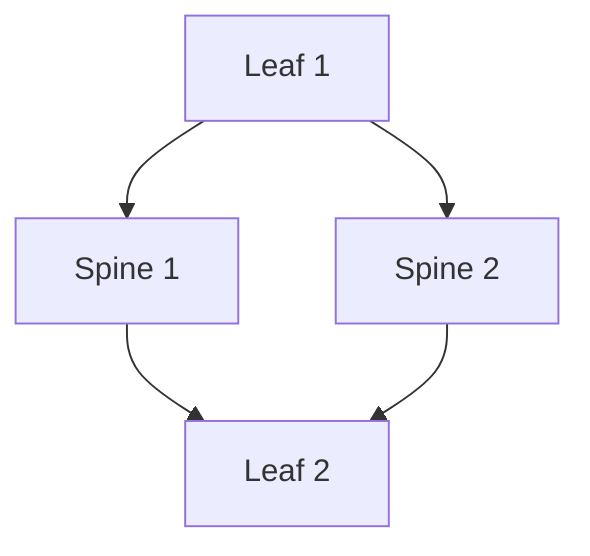

# Modelos de Rede e Arquitetura

> **Origem:** revisão do CCNA Data Center — DCICN 640-911, páginas 1–2 das anotações manuscritas.
>
> **Objetivo:** consolidar os fundamentos para os estudos do CCNP Data Center DCCOR 350-601.

## 1. Modos de Comunicação

Os modos de comunicação definem como os dispositivos transmitem e recebem informações através de um meio de comunicação.

A principal diferença entre eles está na **direção em que os dados podem circular** e na **possibilidade de transmissão simultânea**.

Existem três modos principais de comunicação: **Simplex, Half-duplex e Full-duplex**.

### 1.1 Simplex

A comunicação **simplex** ocorre em apenas um sentido. Um dispositivo atua como transmissor e o outro como receptor, sem que exista comunicação de retorno pelo mesmo canal.

**Exemplos:**

- Transmissões tradicionais de rádio e televisão.
- Sistemas de sensores que apenas enviam informações.
- Sistemas de distribuição de sinais unidirecionais.

Nesse modelo, o receptor não consegue responder ao emissor através do mesmo canal de comunicação.

### 1.2 Half-duplex

Na comunicação **half-duplex**, ambos os dispositivos podem transmitir e receber dados, mas não simultaneamente.

A transmissão ocorre de maneira alternada: enquanto um dispositivo transmite, o outro recebe.

**Exemplos:**

- Rádios comunicadores (*walkie-talkies*).
- Redes Ethernet antigas que utilizavam hubs.
- Conexões Ethernet operando em half-duplex.

> **Importante:** As setas representam os dois sentidos possíveis de comunicação, mas as transmissões não ocorrem simultaneamente.

#### Half-duplex em redes Ethernet

Nas redes Ethernet tradicionais com hubs, os dispositivos compartilham o mesmo meio de transmissão e pertencem ao mesmo domínio de colisão.

Para controlar o acesso ao meio compartilhado, utiliza-se o mecanismo **CSMA/CD (Carrier Sense Multiple Access with Collision Detection)**. [Ver Mais](#)

Seu funcionamento básico consiste em:

1. O dispositivo verifica se o meio está disponível.
2. Se estiver livre, inicia a transmissão.
3. Se ocorrer uma colisão, a transmissão é interrompida.
4. Os dispositivos aguardam um intervalo de tempo calculado antes de tentar novamente.

Esse mecanismo era fundamental nas redes Ethernet compartilhadas, mas deixou de ser utilizado nas conexões Ethernet full-duplex modernas.

### 1.3 Full-duplex

Na comunicação **full-duplex**, os dispositivos podem transmitir e receber dados simultaneamente, sem precisar alternar o sentido da comunicação.

Esse é o modo habitual de funcionamento das conexões Ethernet modernas entre switches, servidores e outros equipamentos de rede.

**Exemplos:**

- Conexões Ethernet entre servidores e switches.
- Links entre switches Cisco Nexus.
- Conexões Ethernet entre equipamentos de armazenamento e switches.

Diferentemente do half-duplex, as duas direções podem ser utilizadas ao mesmo tempo.

Em uma conexão Ethernet ponto a ponto operando em full-duplex, não existem colisões decorrentes da disputa por um meio compartilhado. Portanto, o mecanismo CSMA/CD não é utilizado.

### 1.4 Comparação dos modos de comunicação

| Característica | Simplex | Half-duplex | Full-duplex |
|---|---|---|---|
| Direção da comunicação | Unidirecional | Bidirecional | Bidirecional |
| Transmissão simultânea nos dois sentidos | Não | Não | Sim |
| Alternância entre transmissão e recepção | Não aplicável | Necessária | Desnecessária |
| Exemplo | Rádio tradicional | Walkie-talkie | Ethernet com switch |
| Colisões em Ethernet | Não aplicável | Possíveis em meio compartilhado | Não ocorrem na ligação ponto a ponto |

### 1.5 Aplicação em Data Centers

Em Data Centers modernos, as conexões Ethernet entre servidores, switches e equipamentos de armazenamento normalmente operam em **full-duplex**.

Isso permite que um dispositivo transmita e receba informações simultaneamente, aproveitando a capacidade da interface em cada direção.

#### Exemplo: interface Ethernet de 10 Gbps

Considere um servidor conectado a um switch Cisco Nexus através de uma interface Ethernet de 10 Gbps full-duplex.

Essa interface pode operar com:

- **Transmissão (TX):** até 10 Gbps.
- **Recepção (RX):** até 10 Gbps.
- **Operação simultânea:** transmissão e recepção ocorrendo ao mesmo tempo.

Portanto, é possível existir um fluxo agregado de até 20 Gbps, somando as duas direções, embora a capacidade nominal de cada direção continue sendo 10 Gbps.

> **Atenção:** Isso não significa que uma única transferência unidirecional possa atingir 20 Gbps. Além disso, a taxa útil das aplicações depende dos protocolos e dos overheads envolvidos.

#### Duplex mismatch

O **duplex mismatch** ocorre quando as duas extremidades de uma conexão Ethernet operam com configurações de duplex incompatíveis.

Por exemplo:

- Switch A configurado em full-duplex.
- Switch B configurado em half-duplex.

Essa incompatibilidade pode provocar:

- Redução significativa de desempenho.
- Colisões e colisões tardias no lado half-duplex.
- Erros e retransmissões.
- Baixa taxa de transferência, mesmo com o link ativo.

Esse problema está associado principalmente a interfaces Ethernet que suportam half-duplex, como determinadas interfaces de 10/100 Mbps.

Interfaces Ethernet modernas de alta velocidade normalmente operam exclusivamente em full-duplex.

### 1.6 Checklist de revisão

- [ ] Compreender a diferença entre simplex, half-duplex e full-duplex.
- [ ] Identificar exemplos de utilização de cada modo.
- [ ] Entender por que o CSMA/CD era necessário nas redes Ethernet compartilhadas.
- [ ] Compreender por que o CSMA/CD não é utilizado em Ethernet full-duplex.
- [ ] Diferenciar capacidade de transmissão e recepção de uma interface.
- [ ] Entender os efeitos de um duplex mismatch.

## 2. Arquitetura Hierárquica de Rede

A **arquitetura hierárquica de rede** é um modelo de projeto que organiza a infraestrutura em camadas, atribuindo funções e responsabilidades específicas a cada uma delas.

Seu principal objetivo é criar redes mais **escaláveis, resilientes, organizadas e fáceis de administrar**, evitando que todos os dispositivos e serviços sejam conectados de maneira desestruturada.

O modelo clássico de arquitetura hierárquica da Cisco é composto por três camadas:

1. **Core (Núcleo):** responsável pelo transporte rápido e confiável do tráfego.
2. **Distribution (Distribuição):** responsável pela agregação, aplicação de políticas e interconexão.
3. **Access (Acesso):** responsável pela conectividade dos dispositivos finais.

### 2.1 Visão geral da arquitetura

### 2.2 Camada Core (Núcleo)

A camada **Core** representa o backbone da rede, sendo responsável por interconectar os diferentes blocos de distribuição e transportar grandes volumes de tráfego.

Sua principal característica é a capacidade de realizar o encaminhamento de pacotes com **alta performance, baixa latência e elevada disponibilidade**.

#### Principais responsabilidades

- Encaminhar tráfego entre diferentes blocos da infraestrutura.
- Disponibilizar conectividade de alta velocidade.
- Oferecer caminhos redundantes para evitar pontos únicos de falha.
- Garantir convergência rápida em caso de falhas.
- Suportar o crescimento da rede sem comprometer o desempenho.

#### Características técnicas

Os equipamentos utilizados no Core normalmente possuem:

- Interfaces de alta velocidade, como 10, 25, 40, 100 ou 400 Gbps, conforme a plataforma.
- Elevada capacidade de switching e forwarding.
- Recursos de redundância de hardware e software.
- Suporte a protocolos de roteamento dinâmico.
- Capacidade de encaminhamento em hardware, utilizando ASICs.

Uma boa prática no modelo clássico é manter o Core relativamente simples, evitando políticas complexas que possam dificultar a operação e a convergência.

#### Exemplo prático

Imagine uma organização com três edifícios, cada um contendo sua própria infraestrutura de rede.

Os switches Core podem interconectar os blocos de distribuição desses edifícios, permitindo que o tráfego entre eles seja encaminhado através do backbone.

Caso um dos equipamentos Core falhe, a arquitetura pode utilizar um caminho alternativo, desde que a redundância e os protocolos estejam corretamente configurados.

### 2.3 Camada de Distribuição (Distribution)

A camada de **Distribuição** estabelece a conexão entre os switches de acesso e o Core.

Além de agregar o tráfego proveniente da camada de acesso, essa camada normalmente representa um ponto importante para aplicação de políticas e controle do tráfego.

#### Principais responsabilidades

- Agregar as conexões provenientes dos switches de acesso.
- Implementar políticas de segurança e controle de tráfego.
- Realizar roteamento entre VLANs, quando essa função estiver posicionada na distribuição.
- Aplicar mecanismos de filtragem, como ACLs.
- Implementar políticas de QoS.
- Estabelecer limites entre domínios de camada 2 e camada 3.
- Oferecer redundância para os equipamentos de acesso.

#### Tecnologias utilizadas

Dependendo do projeto, a camada de distribuição pode utilizar:

- **VLANs:** segmentação lógica da rede.
- **SVIs (Switch Virtual Interfaces):** interfaces de camada 3 associadas a VLANs.
- **HSRP/VRRP:** redundância de gateway.
- **OSPF/BGP:** roteamento dinâmico, conforme a arquitetura.
- **ACLs:** controle de tráfego entre redes.
- **Port-Channel/LACP:** agregação de links físicos.

#### Exemplo prático

Considere uma infraestrutura com três VLANs:

| VLAN | Finalidade | Rede IPv4 |
|---|---|---|
| 10 | Servidores de aplicação | 10.10.10.0/24 |
| 20 | Servidores de banco de dados | 10.10.20.0/24 |
| 30 | Gerenciamento | 10.10.30.0/24 |

Em uma arquitetura na qual os gateways estejam na distribuição, os switches dessa camada podem realizar o roteamento entre as VLANs.

Também podem aplicar ACLs para impedir que determinados servidores acessem diretamente a rede de gerenciamento.

Dessa forma, a distribuição não atua apenas como ponto de conexão, mas também como uma camada de controle.

### 2.4 Camada de Acesso (Access)

A camada de **Acesso** representa o ponto de conexão dos dispositivos finais à infraestrutura de rede.

É nessa camada que normalmente são conectados servidores, estações de trabalho, telefones IP, pontos de acesso e outros equipamentos.

Em Data Centers tradicionais, os switches de acesso também podem ser conhecidos como **Top-of-Rack (ToR)** ou **End-of-Row (EoR)**, dependendo de seu posicionamento físico.

#### Principais responsabilidades

- Disponibilizar conectividade aos dispositivos finais.
- Oferecer densidade de portas adequada.
- Associar interfaces às VLANs correspondentes.
- Implementar controles de acesso na borda.
- Aplicar políticas de QoS quando necessário.
- Fornecer redundância de conectividade aos servidores.

#### Características técnicas

A escolha dos equipamentos de acesso depende das necessidades da infraestrutura.

Em redes corporativas, podem ser importantes recursos como:

- Portas Ethernet de 1 Gbps.
- PoE para telefones IP e pontos de acesso.
- Autenticação 802.1X.
- Port Security.

Em Data Centers, os requisitos frequentemente são diferentes:

- Interfaces de 10, 25, 50 ou 100 Gbps para servidores, conforme a plataforma.
- Alta densidade de interfaces.
- Baixa latência.
- Suporte a VLANs e Port-Channels.
- Recursos de redundância, como vPC em plataformas Cisco Nexus compatíveis.

#### Exemplo prático

Considere um rack contendo 20 servidores, cada um com duas interfaces Ethernet de 10 Gbps.

Uma possibilidade é conectar cada servidor a dois switches de acesso distintos, oferecendo redundância física.

A utilização efetiva das duas conexões depende da configuração adotada, como bonding, teaming, multipathing ou Port-Channel com vPC.

> **Importante:** A existência de duas interfaces conectadas a switches distintos não garante, por si só, redundância funcional. É necessário configurar corretamente os mecanismos de failover e encaminhamento.

### 2.5 Comparação das três camadas

| Característica | Core | Distribuição | Acesso |
|---|---|---|---|
| Função principal | Transporte rápido | Agregação e políticas | Conectividade final |
| Prioridade | Performance e disponibilidade | Controle e agregação | Densidade e conectividade |
| Roteamento | Frequente | Frequente | Depende do projeto |
| ACLs e políticas | Normalmente minimizadas | Frequentemente aplicadas | Aplicadas conforme necessidade |
| Conexão típica | Outros blocos de rede | Core e acesso | Servidores e dispositivos finais |
| Exemplo de equipamento | Switch de backbone | Switch de agregação | Switch ToR ou de acesso |

### 2.6 Benefícios da arquitetura hierárquica

#### Escalabilidade

A separação em camadas permite expandir a infraestrutura de forma modular.

Por exemplo, novos switches de acesso podem ser adicionados sem exigir uma reformulação completa do Core.

#### Redundância e disponibilidade

A utilização de equipamentos e caminhos redundantes reduz a dependência de um único componente.

Entretanto, a redundância deve ser acompanhada de mecanismos adequados de prevenção de loops, roteamento e convergência.

#### Organização e modularidade

Cada camada possui responsabilidades bem definidas.

Essa separação facilita a padronização das configurações e o planejamento de mudanças.

#### Facilidade de troubleshooting

Quando ocorre uma falha, a organização hierárquica ajuda a delimitar a investigação.

Por exemplo:

- **Acesso:** verificar a interface do servidor, VLAN e estado do link.
- **Distribuição:** verificar gateways, ACLs e roteamento entre redes.
- **Core:** verificar a conectividade entre blocos e as rotas do backbone.

### 2.7 Arquitetura de duas camadas (Collapsed Core)

Nem todas as redes precisam utilizar três camadas físicas distintas.

Em ambientes menores, é comum utilizar uma arquitetura denominada **Collapsed Core**, na qual as funções de Core e Distribuição são combinadas.

Essa abordagem pode reduzir custos e complexidade, mantendo parte dos benefícios da arquitetura hierárquica.

A decisão depende de fatores como:

- Quantidade de dispositivos.
- Volume de tráfego.
- Requisitos de disponibilidade.
- Necessidade de expansão.
- Orçamento disponível.

### 2.8 Atualização para Data Centers: Arquitetura Spine-Leaf

Embora a arquitetura hierárquica de três camadas continue importante, muitos Data Centers modernos utilizam a arquitetura **Spine-Leaf**.

Essa arquitetura é normalmente organizada em duas funções principais:

- **Spine:** switches responsáveis pela interconexão dos Leafs.
- **Leaf:** switches que conectam servidores, sistemas de armazenamento e outros dispositivos.

Em uma topologia Spine-Leaf típica, cada Leaf possui conexões com todos os Spines.

> **Nota técnica — Redundância de servidores (Single-Homed vs. Dual-Homed):**
>
> Em uma arquitetura Spine-Leaf, os servidores podem estar conectados a um único Leaf (**Single-Homed**) ou a dois Leafs distintos (**Dual-Homed**).
>
> - **Single-Homed:** o servidor possui conectividade através de um único Leaf. Caso esse switch falhe, o servidor perde a conectividade por esse caminho.
> - **Dual-Homed:** o servidor possui conexões com dois Leafs distintos, permitindo manter a conectividade em caso de falha de um deles, desde que os mecanismos de redundância estejam corretamente configurados.
>
> Em Data Centers que exigem alta disponibilidade, a conexão Dual-Homed é frequentemente utilizada. Dependendo da arquitetura, essa redundância pode ser implementada através de **vPC (Cisco Nexus), NIC Teaming/Bonding ou EVPN Multihoming**, conforme o suporte dos equipamentos.
>
> **Importante:** a arquitetura Spine-Leaf não exige obrigatoriamente que todos os servidores sejam Dual-Homed. A escolha depende dos requisitos de disponibilidade, desempenho e desenho da infraestrutura.

#### Por que utilizar Spine-Leaf?

A arquitetura foi desenvolvida para atender requisitos comuns em Data Centers, como:

- Elevado volume de tráfego entre servidores.
- Necessidade de baixa latência.
- Crescimento horizontal da infraestrutura.
- Utilização eficiente de múltiplos caminhos.
- Integração com tecnologias de virtualização e redes overlay.

#### Tráfego North-South e East-West

Em redes de Data Center, o tráfego pode ser classificado de acordo com seu sentido lógico.

**North-South:** tráfego entre os sistemas do Data Center e redes externas, como Internet, WAN ou usuários.

**East-West:** tráfego entre servidores e aplicações dentro do próprio Data Center.

Exemplo de tráfego East-West:

1. Um servidor Web recebe uma solicitação.
2. O servidor Web consulta um servidor de aplicação.
3. O servidor de aplicação consulta um banco de dados.
4. As respostas retornam pelos caminhos correspondentes.

Grande parte dessa comunicação pode ocorrer entre servidores localizados em racks diferentes.

#### ECMP (Equal-Cost Multi-Path)

Uma das vantagens de uma arquitetura Spine-Leaf com underlay de camada 3 é a possibilidade de utilizar **ECMP**.

O ECMP permite que o roteamento utilize múltiplos caminhos de mesmo custo para alcançar determinado destino.

Nesse exemplo, o Leaf 1 possui dois caminhos de mesmo custo para alcançar o Leaf 2.

O equipamento pode distribuir fluxos entre esses caminhos, normalmente utilizando um cálculo de hash baseado em campos dos pacotes.

> **Atenção:** ECMP não significa necessariamente dividir cada pacote individualmente entre os caminhos. A distribuição por fluxo é utilizada com frequência para evitar reordenação de pacotes.

### 2.9 Arquitetura hierárquica vs. Spine-Leaf

| Característica | Hierárquica tradicional | Spine-Leaf |
|---|---|---|
| Organização | Core, Distribuição e Acesso | Spine e Leaf |
| Objetivo original | Modularidade e segmentação funcional | Escalabilidade e conectividade de Data Center |
| Caminhos redundantes | Dependem do projeto | Múltiplos caminhos entre Leafs |
| Tráfego East-West | Pode exigir passagem por camadas de agregação | Normalmente percorre Leaf-Spine-Leaf |
| Escalabilidade | Expansão por blocos hierárquicos | Expansão horizontal de Leafs e Spines |
| Tecnologias comuns | STP, VLAN, HSRP, roteamento | ECMP, BGP, VXLAN EVPN |
| Aplicação | Redes corporativas e Data Centers tradicionais | Data Centers modernos |

> **Nota técnica:** Spine-Leaf não é simplesmente uma mudança de nomes das camadas tradicionais. Trata-se de uma arquitetura com características próprias de conectividade e escalabilidade.

### 2.10 Relação com o CCNP DCCOR 350-601

O conhecimento dessas arquiteturas é fundamental para compreender os seguintes tópicos do DCCOR:

- **Cisco Nexus:** funções dos switches em diferentes arquiteturas de Data Center.
- **vPC:** redundância e conectividade de dispositivos a switches Nexus.
- **OSPF e BGP:** protocolos de roteamento utilizados na infraestrutura.
- **ECMP:** utilização de múltiplos caminhos de mesmo custo.
- **VXLAN EVPN:** construção de redes overlay sobre um underlay IP.
- **Cisco ACI:** arquitetura baseada em switches Spine e Leaf.
- **Data Center Design:** requisitos de disponibilidade, escalabilidade e desempenho.

É importante compreender tanto a arquitetura tradicional quanto o Spine-Leaf, pois ambas ajudam a explicar a evolução das redes de Data Center.

### 2.11 Checklist de revisão

- [ ] Compreender o objetivo de uma arquitetura hierárquica.
- [ ] Identificar as responsabilidades das camadas Core, Distribuição e Acesso.
- [ ] Entender a função da camada de Distribuição na aplicação de políticas.
- [ ] Compreender a importância da redundância entre as camadas.
- [ ] Diferenciar a arquitetura de três camadas do Collapsed Core.
- [ ] Compreender as funções dos switches Spine e Leaf.
- [ ] Diferenciar tráfego North-South e East-West.
- [ ] Entender o funcionamento básico do ECMP.
- [ ] Relacionar Spine-Leaf com BGP, VXLAN EVPN e Cisco ACI.
