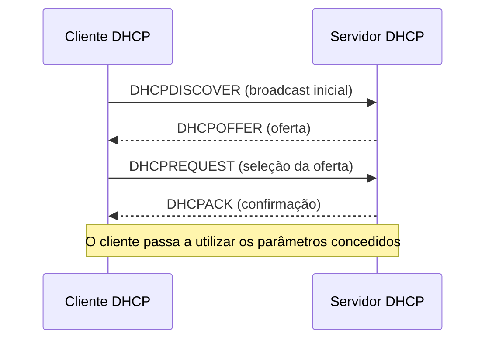
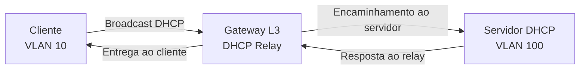
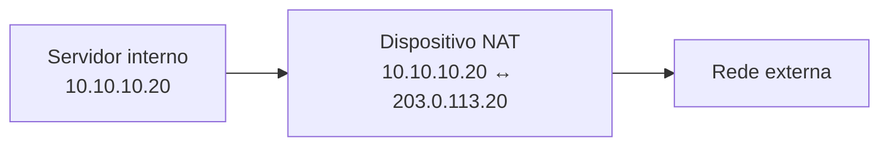
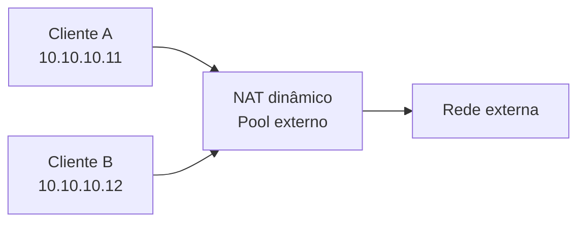
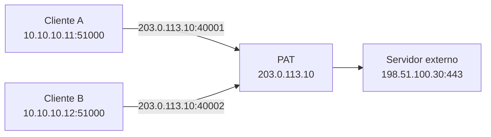
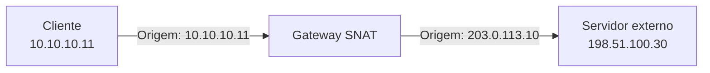
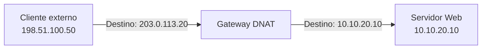
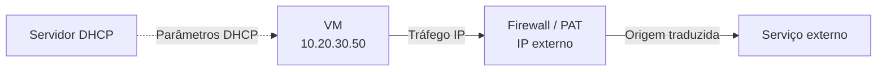

# Serviços de Rede — DHCP, NAT e PAT

> **Revisão CCNA Data Center — DCICN 640-911**  
> **Origem:** anotações manuscritas, páginas 5–6.  
> **Objetivo:** compreender a atribuição dinâmica de parâmetros IPv4 e os mecanismos de tradução de endereços, relacionando os fundamentos com operações de Data Center.

## 1. Visão geral

Os serviços de rede complementam o endereçamento IP e permitem que dispositivos sejam configurados e se comuniquem em diferentes cenários.

Neste módulo, estudaremos:

- **DHCP (Dynamic Host Configuration Protocol):** fornece parâmetros de rede automaticamente aos clientes.
- **NAT (Network Address Translation):** traduz endereços IP entre espaços de endereçamento.
- **PAT (Port Address Translation):** utiliza também identificadores de transporte, como portas TCP/UDP, para distinguir traduções.

## 2. DHCP — Dynamic Host Configuration Protocol

O **DHCP** automatiza a distribuição de parâmetros de rede. Em vez de configurar manualmente cada dispositivo, um servidor DHCP pode fornecer endereço IP, máscara, gateway padrão, servidores DNS e outros parâmetros.

### 2.1 Por que utilizar DHCP?

Imagine uma rede com centenas de estações de trabalho, máquinas virtuais. Configurar cada equipamento manualmente aumenta o esforço operacional e o risco de endereços duplicados.

O DHCP ajuda a:

- Centralizar a administração de endereços.
- Reduzir erros de configuração.
- Reaproveitar endereços que não estão mais em uso.
- Alterar parâmetros, como DNS e gateway, de forma coordenada.

> **Atenção:** nem todo dispositivo de um Data Center deve utilizar DHCP. Endereços de infraestrutura, interfaces de roteamento e serviços críticos podem exigir configuração estática ou reservas, conforme o projeto.

### 2.2 Componentes de uma implantação DHCP

| Componente | Função |
|---|---|
| **Cliente DHCP** | Solicita parâmetros de rede |
| **Servidor DHCP** | Mantém escopos e oferece configurações |
| **Pool / Escopo** | Conjunto de endereços e opções disponíveis |
| **Lease (concessão)** | Período durante o qual o cliente pode utilizar o endereço |
| **DHCP Relay** | Encaminha mensagens entre clientes e servidores em sub-redes diferentes |
| **Reserva** | Associa um endereço a uma identidade de cliente, segundo a implementação |

**Exemplo de escopo IPv4:**

| Parâmetro | Valor ilustrativo |
|---|---|
| Rede | `192.168.50.0/24` |
| Pool | `192.168.50.100–192.168.50.200` |
| Gateway | `192.168.50.1` |
| DNS | `192.168.50.10` |
| Lease | 24 horas |

### 2.3 Processo DORA

Nas anotações, o estabelecimento inicial de um endereço IPv4 é descrito em quatro etapas, conhecidas como **DORA**:

1. **Discover:** o cliente procura servidores DHCP.
2. **Offer:** um servidor oferece um endereço e parâmetros.
3. **Request:** o cliente solicita a oferta escolhida.
4. **ACK (Acknowledgment):** o servidor confirma a concessão.

#### Discover

Um cliente que ainda não possui endereço IPv4 utilizável geralmente inicia o processo com:

- **IP de origem:** `0.0.0.0`
- **IP de destino:** `255.255.255.255`
- **UDP origem:** porta `68`
- **UDP destino:** porta `67`

A mensagem inicial é transmitida por broadcast porque o cliente ainda não sabe onde está o servidor.

#### Offer

O servidor responde com uma oferta que pode conter o endereço disponível, máscara, tempo de concessão e outras opções.

#### Request

O cliente indica qual oferta deseja aceitar. No processo inicial, o `DHCPREQUEST` costuma ser enviado em broadcast, permitindo que outros servidores saibam que suas ofertas não foram escolhidas.

#### ACK

O servidor confirma os parâmetros por meio de `DHCPACK`. Em determinadas situações pode responder com `DHCPNAK`, informando que a configuração solicitada não é válida.

### 2.4 DHCP utiliza TCP ou UDP?

O DHCPv4 utiliza **UDP**:

| Sentido | Porta |
|---|---|
| Cliente → Servidor | UDP **67** (destino) |
| Servidor → Cliente | UDP **68** (destino) |

O protocolo não depende de uma conexão TCP prévia para atribuir um endereço IP.

### 2.5 Lease e renovação

O endereço concedido normalmente tem um período de validade chamado **lease**.

Em uma configuração comum:

- **T1:** o cliente tenta renovar a concessão, normalmente após 50% do tempo.
- **T2:** se não conseguiu renovar, tenta novamente em um escopo mais amplo, normalmente após 87,5%.
- **Expiração:** se não houver renovação válida, o cliente não deve continuar utilizando o endereço expirado.

Os tempos podem ser definidos por opções do servidor; os percentuais são valores padrão comuns, não garantias universais.

### 2.6 DHCP Relay

Mensagens de broadcast IPv4 normalmente não atravessam roteadores. Por isso, quando o servidor DHCP está em outra sub-rede, utiliza-se um **DHCP Relay**.

**Exemplo de topologia:**

- Cliente na VLAN 10: `10.10.10.0/24`.
- Gateway da VLAN 10: `10.10.10.1`.
- Servidor DHCP: `10.10.100.20`.

O relay recebe a solicitação na VLAN 10 e a encaminha ao servidor, normalmente preenchendo informações que permitem identificar a rede de origem do cliente.

### 2.7 Segurança e troubleshooting do DHCP

Problemas comuns:

| Sintoma | Possível causa | Verificação |
|---|---|---|
| Cliente não recebe IP | VLAN incorreta, relay ausente, servidor inacessível | VLAN, SVI, rotas e captura DHCP |
| Recebe IP, mas não navega | Gateway ou DNS incorreto | Opções DHCP e rotas |
| Recebe IP inesperado | Servidor DHCP não autorizado | Inspeção de tráfego e recursos de proteção |
| Pool esgotado | Excesso de concessões ou escopo pequeno | Utilização do pool e leases |

Um **servidor DHCP não autorizado (rogue DHCP)** pode distribuir parâmetros errados ou maliciosos. Recursos como **DHCP Snooping**, quando suportados e corretamente configurados, ajudam a restringir respostas DHCP a interfaces confiáveis.

## 3. NAT — Network Address Translation

O **NAT** altera informações de endereçamento IP em pacotes que atravessam um dispositivo responsável pela tradução.

Um uso conhecido é permitir que dispositivos com endereços IPv4 privados acessem serviços externos utilizando endereços públicos. Porém, o NAT também pode ser empregado em integrações de redes, migrações e ambientes com endereçamento sobreposto.

> **Importante:** NAT não é, por si só, um firewall nem substitui uma política de segurança. Além disso, a comunicação entre redes privadas **não exige NAT** quando existe roteamento adequado.

### 3.1 Endereços privados e públicos

O RFC 1918 define os seguintes blocos privados:

| Bloco | Prefixo |
|---|---|
| `10.0.0.0 – 10.255.255.255` | `10.0.0.0/8` |
| `172.16.0.0 – 172.31.255.255` | `172.16.0.0/12` |
| `192.168.0.0 – 192.168.255.255` | `192.168.0.0/16` |

Esses endereços não são globalmente roteáveis na Internet pública. O NAT pode fazer parte da solução de acesso externo, mas a tradução precisa estar acompanhada de roteamento e das políticas necessárias.

### 3.2 Terminologia Cisco: inside e outside

Na terminologia tradicional de NAT da Cisco:

- **Inside local:** endereço do dispositivo interno conforme aparece na rede interna.
- **Inside global:** endereço pelo qual esse dispositivo interno é representado no lado externo.
- **Outside global:** endereço real do dispositivo externo.
- **Outside local:** endereço do dispositivo externo conforme é visto na rede interna.

Em muitos exemplos simples, *outside local* e *outside global* possuem o mesmo valor.

### 3.3 NAT estático (Static NAT)

O **NAT estático** cria um mapeamento fixo entre endereços, geralmente **um para um (1:1)**.

**Exemplo:**

| Endereço interno | Endereço traduzido |
|---|---|
| `10.10.10.20` | `203.0.113.20` |

O mapeamento permanece definido independentemente de haver tráfego ativo.

**Quando utilizar:** publicação ou integração de um serviço com endereço traduzido estável, quando o projeto exige esse tipo de mapeamento.

> **Nota:** `203.0.113.0/24` é um bloco reservado para documentação, utilizado aqui apenas em exemplos (RFC 5727 e 6890).

### 3.4 NAT dinâmico (Dynamic NAT)

O **NAT dinâmico** utiliza um conjunto (*pool*) de endereços disponíveis para criar traduções conforme a necessidade.

**Exemplo de pool:**

`203.0.113.100 – 203.0.113.102`

As traduções são alocadas conforme a configuração e a disponibilidade de endereços. Em NAT dinâmico tradicional sem sobrecarga de portas, o número de mapeamentos simultâneos é limitado pelo pool.

### 3.5 PAT — Port Address Translation

O **PAT**, também chamado de **NAT overload** em muitos contextos Cisco, permite que múltiplas conexões internas compartilhem um mesmo endereço IPv4 externo.

Além do endereço IP, o dispositivo utiliza informações de transporte, como portas TCP/UDP, para diferenciar os fluxos.

**Exemplo simplificado de tabela de traduções:**

| Origem interna | Origem traduzida | Destino |
|---|---|---|
| `10.10.10.11:51000` | `203.0.113.10:40001` | `198.51.100.30:443` |
| `10.10.10.12:51000` | `203.0.113.10:40002` | `198.51.100.30:443` |

Quando as respostas retornam, o equipamento consulta o estado da tradução para entregá-las ao cliente correto.

> **Precisão técnica:** a tradução não é identificada apenas pelo número de porta. O protocolo e, conforme a implementação, outros campos do fluxo também participam da identificação.

### 3.6 Comparação entre NAT estático, dinâmico e PAT

| Característica | NAT estático | NAT dinâmico | PAT |
|---|---|---|---|
| Mapeamento | Fixo | Alocado sob demanda | Alocado por fluxo/tradução |
| Relação típica | 1:1 | 1:1 temporária | Muitos:1, frequentemente |
| Uso de portas para multiplexar | Não é necessário | Não é necessário | Sim, para TCP/UDP |
| Consumo de endereços externos | Um por mapeamento | Depende do pool | Pode compartilhar um endereço |
| Aplicação comum | Endereço externo estável | Traduções usando pool | Saída compartilhada para redes externas |

### 3.7 NAT de origem e NAT de destino

Além de classificar o NAT como estático ou dinâmico, podemos
diferenciá-lo de acordo com o endereço IP que será traduzido.

#### SNAT (Source NAT)

O **SNAT** modifica o endereço IP de origem de um pacote.

É frequentemente utilizado quando dispositivos de uma rede
privada precisam acessar redes externas.

**Exemplo:**

Um cliente com endereço `10.10.10.11` deseja acessar um
servidor externo `198.51.100.30`.

Antes da tradução:

- Origem: `10.10.10.11`
- Destino: `198.51.100.30`

Após a tradução:

- Origem: `203.0.113.10`
- Destino: `198.51.100.30`

Observe que apenas o endereço de origem foi alterado
nesse exemplo.

O dispositivo NAT mantém as informações necessárias
para realizar a tradução inversa do tráfego de retorno.

#### DNAT (Destination NAT)

O **DNAT** modifica o endereço IP de destino de um pacote.

É frequentemente utilizado para disponibilizar serviços
internos através de endereços externos.

**Exemplo:**

Um servidor Web possui o endereço privado `10.10.20.10`,
mas é publicado através do endereço `203.0.113.20`.

Antes da tradução:

- Origem: `198.51.100.50`
- Destino: `203.0.113.20`

Após a tradução:

- Origem: `198.51.100.50`
- Destino: `10.10.20.10`

Observe que o endereço de origem permanece inalterado
nesse exemplo, enquanto o destino é traduzido.

O dispositivo NAT também precisa realizar a tradução
inversa das respostas.

#### Diferença entre SNAT, DNAT e PAT

SNAT e DNAT identificam **qual endereço IP é modificado**.

Já o PAT utiliza informações de transporte, como portas
TCP/UDP, para realizar ou distinguir traduções.

Portanto, os conceitos podem ser combinados:

| Cenário | Tradução |
|---|---|
| Cliente privado acessando a Internet com NAT 1:1 | SNAT |
| Vários clientes compartilhando um IP externo | SNAT com PAT |
| Publicação de servidor interno por IP externo | DNAT |
| Redirecionamento de TCP 8443 externo para TCP 443 interno | DNAT com tradução de porta |

> **Importante:** SNAT e DNAT descrevem a direção da
> tradução dos endereços. NAT estático, dinâmico e PAT
> descrevem características do mapeamento realizado.
> Essas classificações não são mutuamente exclusivas.

### 3.8 NAT em Data Centers

Em Data Centers, a tradução pode aparecer em:

- **Saída de servidores e aplicações:** acesso a repositórios, APIs ou serviços externos.
- **Publicação de serviços:** exposição controlada de aplicações por meio de endereços ou portas traduzidos.
- **Integração entre ambientes:** interconexão de redes com faixas IPv4 sobrepostas.
- **Migrações:** manutenção temporária de conectividade durante mudanças de endereçamento.

Em muitas arquiteturas, o NAT é executado por **firewalls, appliances ou serviços específicos**, e não necessariamente pelos switches Spine ou Leaf.

#### NAT e balanceamento de carga

NAT e *load balancing* são conceitos distintos:

- **NAT:** altera informações de endereçamento e, em alguns casos, portas.
- **Load balancing:** distribui conexões ou requisições entre destinos, segundo regras e verificações de disponibilidade.

Um balanceador pode utilizar NAT como parte de sua implementação, mas os dois conceitos não são equivalentes.

### 3.9 Troubleshooting de NAT/PAT

| Sintoma | Possível causa |
|---|---|
| Cliente não acessa serviço externo | Falta de rota, política, tradução ou DNS |
| Algumas conexões falham sob carga | Limites de traduções ou esgotamento de portas |
| Serviço publicado não responde | DNAT incorreto, rota de retorno ou bloqueio |
| Aplicação falha apesar de TCP conectado | Protocolo com endereços embutidos, inspeção ou timeout |
| Tráfego funciona apenas em um sentido | Assimetria de caminhos ou estado NAT indisponível no retorno |

**Verificações gerais:**

1. Confirmar endereços, máscara, gateway e DNS.
2. Verificar rotas de ida e retorno.
3. Examinar políticas de segurança.
4. Consultar a tabela de traduções no dispositivo que realiza NAT.
5. Validar se o fluxo de retorno atravessa o equipamento correto.
6. Utilizar capturas de pacotes quando necessário.

> **Atenção para laboratórios Cisco:** os comandos de NAT dependem muito da plataforma e do sistema operacional. Não é correto assumir que comandos de NAT do IOS/IOS-XE estejam disponíveis da mesma forma em todos os switches Nexus com NX-OS.

## 4. DHCP, NAT e PAT: como se relacionam?

Esses serviços resolvem problemas diferentes:

| Pergunta | Tecnologia |
|---|---|
| Como o dispositivo obtém endereço IP e gateway automaticamente? | **DHCP** |
| Como representar um endereço interno por outro endereço? | **NAT** |
| Como várias conexões podem compartilhar um endereço externo? | **PAT** |

**Cenário integrado:**

1. Uma VM recebe `10.20.30.50/24`, gateway e DNS via DHCP.
2. A VM acessa um repositório externo.
3. O gateway/firewall aplica PAT na saída, conforme a política.
4. As respostas retornam ao firewall e são entregues à VM usando o estado da tradução.

## 5. Relação com o CCNP DCCOR 350-601

Os conceitos estudados aqui ajudam a compreender:

- **Infraestrutura de gerenciamento:** endereçamento de equipamentos e acesso a serviços internos.
- **Redes virtuais:** atribuição de parâmetros a VMs e cargas de trabalho.
- **Segmentação:** necessidade de DHCP Relay quando o servidor está em outra sub-rede.
- **Conectividade externa:** tradução de endereços e políticas em equipamentos de borda.
- **Troubleshooting:** diferenciação entre problemas de atribuição de IP, roteamento, NAT e aplicação.
- **Automação:** provisão consistente de configurações e serviços de rede.

## 6. Exercícios de fixação

1. Descreva as quatro mensagens do processo DORA e a função de cada uma.
2. Por que um cliente DHCP pode precisar de um relay?
3. Quais portas UDP são utilizadas pelo DHCPv4?
4. O que acontece quando um lease expira sem renovação?
5. Qual é a diferença entre NAT estático e NAT dinâmico?
6. Por que o PAT permite compartilhar um endereço IPv4 externo?
7. NAT e firewall são a mesma coisa? Justifique.
8. Um servidor com IP privado precisa obrigatoriamente de NAT para acessar outra sub-rede privada? Explique.
9. Em um Data Center, quais equipamentos poderiam realizar NAT?
10. Se o cliente recebe IP via DHCP, mas não consegue acessar um serviço externo, quais verificações faria primeiro?

## 7. Checklist de revisão

- [ ] Compreender a finalidade do DHCP.
- [ ] Explicar Discover, Offer, Request e ACK.
- [ ] Conhecer as portas UDP 67 e 68.
- [ ] Entender o funcionamento de leases e renovação.
- [ ] Compreender por que DHCP Relay é necessário entre sub-redes.
- [ ] Identificar riscos de servidores DHCP não autorizados.
- [ ] Diferenciar NAT estático, dinâmico e PAT.
- [ ] Explicar o conceito de inside local e inside global.
- [ ] Compreender a diferença entre SNAT e DNAT.
- [ ] Entender a tabela de traduções PAT.
- [ ] Diferenciar NAT de roteamento, firewall e load balancing.
- [ ] Relacionar esses serviços a cenários de Data Center.
